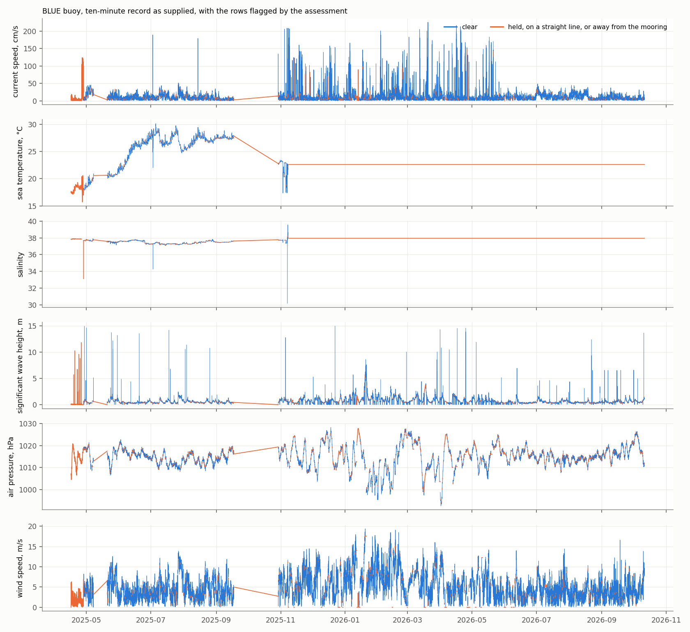
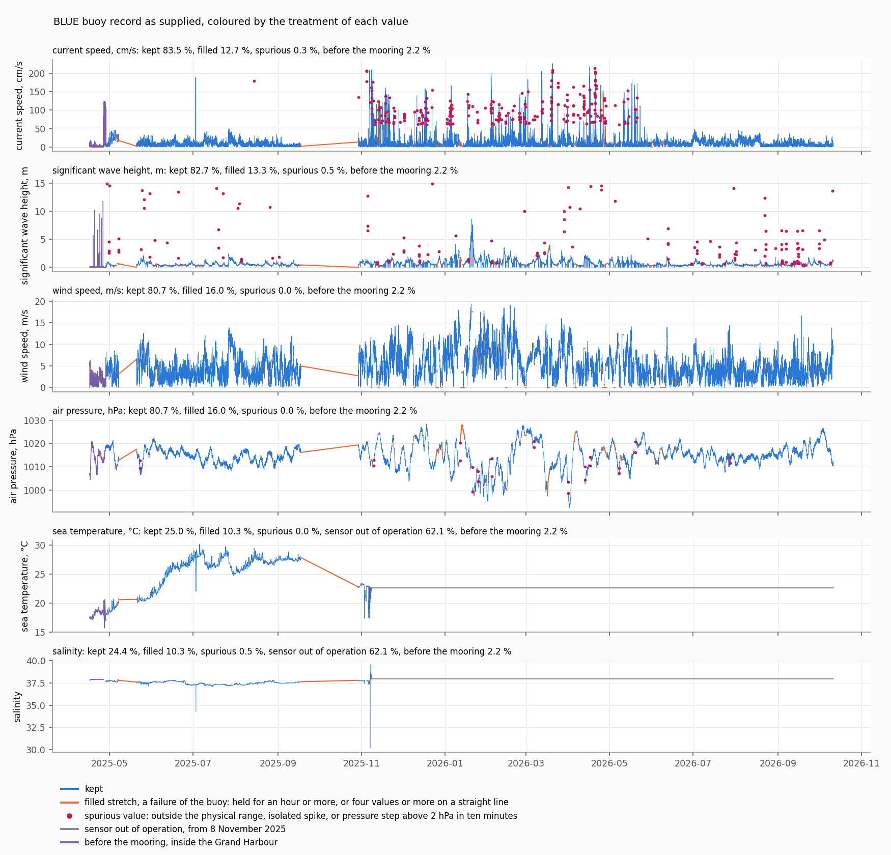

# The BLUE buoy record as supplied

*Received 12 October 2026 from the Oceanography Malta Research Group as `BlueInterpFull.zip`, held at `data/raw/blue_buoy/BlueInterpFull.csv` and not versioned. Assessed by `scripts/assess_blue_buoy.py` and prepared for use by `scripts/prepare_blue_buoy.py`, which writes `data/processed/blue_buoy_10min.csv`. Figures at `figures/blue_buoy_overview.png` and `figures/blue_buoy_treatment.png`.*

The BLUE buoy is moored off the Grand Harbour and is the offshore validation point of the model, the only direct observation of waves in the domain. The file supplied holds its record at ten-minute intervals. It carries no sea level and its pressure is at ten minutes, so it does not serve the test of the long-wave response against the dated milgħuba events, all of which also precede the deployment. That test still depends on the sea level and the one-minute pressure of the PORTO network.

---

## 1. Contents

| | |
|---|---|
| Rows | 78 188, one every ten minutes with no missing time stamp |
| Span | 16 April 2025 09:40 to 11 October 2026 08:50 |
| Mooring | 14.5388 E, 35.9294 N, from 28 April 2025 05:00 |
| Before the mooring | 16 to 28 April 2025 at 14.5008 E, 35.8805 N, inside the Grand Harbour near Marsa |
| Variables | current speed, direction and components, conductivity, salinity, sea temperature, maximum and significant wave height, peak wave direction and period, humidity, air pressure, air temperature, wind and gust speed and direction, latitude, longitude, dilution of precision |
| Units | not stated in the file. Current speed has a median of 7 and reaches 226, which reads as cm/s |
| Flags | none |

The name of the file and the absence of any missing stamp indicate that the gaps of the original record were filled before it was supplied. The filled stretches correspond to failures of the buoy and are disregarded in this study. A filled value cannot be told from a measured one by a flag, so the assessment looks for the traces a filling leaves, namely a value held unchanged for an hour or more and four or more consecutive values on a straight line.

---

## 2. State of the record

*Current speed, sea temperature, salinity, significant wave height, air pressure and wind speed as supplied, with the rows held, on a straight line or recorded away from the mooring in orange.*

Share of rows flagged over the whole file.

| Variable | Outside the physical range | Held for an hour or more | On a straight line | Clear |
|---|---|---|---|---|
| Current speed | 0.0 % | 0.0 % | 12.7 % | 87.3 % |
| Sea temperature | 0.0 % | 62.1 % | 10.3 % | 27.6 % |
| Salinity | 0.9 % | 62.1 % | 10.3 % | 26.7 % |
| Significant wave height | 0.7 % | 1.1 % | 12.4 % | 85.9 % |
| Peak wave period | 0.1 % | 1.0 % | 12.2 % | 86.7 % |
| Air pressure | 0.0 % | 5.8 % | 14.9 % | 79.3 % |
| Wind speed | 0.0 % | 5.9 % | 10.1 % | 84.0 % |

Six matters follow from the table and the figure.

**Two long gaps are filled by straight lines.** From 7 to 20 May 2025, 12.8 days, and from 17 September to 29 October 2025, 41.9 days, every variable lies on a straight line between the values at either end. Shorter filled stretches of 8 to 22 hours occur on 24 further days, many of them ending at 23:40, and the filled stretches common to four variables amount to 66 days in all.

**Sea temperature and salinity stop on 8 November 2025.** The sensor is out of operation, as stated by Prof. Gauci, and both variables are constant in the file, at 22.6032 °C and 37.9537, from 8 November 2025 to its end, 337 days. With the gap that precedes it, the measured temperature and salinity cover 28 April to 17 September 2025, less the gap of May, and ten days in November. The record therefore holds one summer of temperature and salinity, from 17 to 30 °C, and no winter.

**The wave heights carry isolated spikes.** Some 112 values of significant wave height stand above the 70-minute running median by more than a metre and by more than the median itself, up to 14.9 m, and 40 rows of 7 May 2025 hold values near 1.7 × 10⁹ in the four wave columns, which are time stamps written in the place of the measurement. With the spikes removed the largest significant wave height at the mooring is 8.6 m on 20 January 2026 at 10:20, with the largest wind of the record, 19.4 m/s, ten hours earlier. That is Storm Harry.

**The currents change character between November 2025 and May 2026.** In those months 1.5 to 8.4 per cent of the speeds exceed 60 cm/s, in isolated values up to 226 cm/s, against 0.1 per cent or less in the months before and after, while the monthly median stays between 4 and 13 cm/s throughout. The isolated values have the appearance of noise and are to be removed before the record is used, and their cause is to be asked.

**Air pressure and air temperature are reported to 0.1.** At that resolution an hour without change and four values on a line occur in measured data, so the shares held and on a line in the table overstate the filling for these two variables. In the prepared record their filled stretches are taken from the wind, which belongs to the same station.

**The pressure carries steps.** Thirteen changes of more than 2 hPa in ten minutes occur, the largest of 10.6 hPa, nine of them between January and May 2026, where the figure shows the pressure alternating between two levels.

**The first twelve days are inside the Grand Harbour.** From 16 to 28 April 2025 the position is near Marsa, at the head of the harbour, before the deployment. The wave columns are without meaning there, but temperature, salinity and current of those days are measurements inside the basin.

---

## 3. Prepared record

`scripts/prepare_blue_buoy.py` sets missing, variable by variable, the values flagged above, the sea temperature and salinity from 8 November 2025, and three further classes, namely wave values above their 70-minute running median by more than a metre and by more than the median itself, current speeds above 60 cm/s that exceed three times their running median, and pressures on either side of a change above 2 hPa in ten minutes. Rows before the mooring are dropped. The result runs from 28 April 2025 to 11 October 2026.

*The record as supplied, with each value coloured by its treatment. Kept values are in blue, filled stretches in orange, spurious values as crimson points, the span with the sensor out of operation in grey and the days before the mooring in purple. The shares in the panel titles are of the whole file, and those of the table below are of the rows at the mooring.*

The figure shows what the criteria leave in place as well as what they remove. Between November 2025 and May 2026 a number of current speeds of 100 to 200 cm/s remain among the kept values, since the criterion removes a value only when it exceeds three times its running median and these occur in clusters. They are kept until their cause is known, and a validation of the currents over those months is to be read with that reservation.

| Variable | Rows retained | Days |
|---|---|---|
| Current | 85.4 % | 454 |
| Waves | 84.5 % | 449 |
| Wind | 82.5 % | 438 |
| Air pressure | 82.4 % | 438 |
| Sea temperature | 25.5 % | 136 |
| Salinity | 25.0 % | 133 |

From June to August 2025 and from July 2026 onward the retention of current, waves and wind is 95 to 99 per cent of each month, and between November 2025 and June 2026 it is 75 to 98 per cent. It falls to 54 per cent in May and September 2025 and to 8 per cent in October 2025, the months of the two long failures. The values removed inside the well-covered months are short stretches, so that the longest run with current, waves, wind and pressure all present is 3.4 days. Validation statistics are therefore computed on the retained values and not on continuous series.

---

## 4. Use in the study

| Purpose | Usable span | Remarks |
|---|---|---|
| Waves, validation of SWAN | 28 April 2025 to October 2026, less the failures | Storm Harry is covered |
| Currents | the same span | single level, depth of measurement and units to be confirmed |
| Sea temperature and salinity | May to mid-September 2025 | one summer. No stratification, the measurement being at one level |
| Wind and air pressure | the same span as the waves | for comparison with ERA5 and the coastal stations. Pressure at ten minutes does not resolve the jumps that force the long wave |
| Long-wave response | none | no sea level, and all dated events precede the deployment |

A hindcast of some 40 days for validation is best placed where all variables are measured, which is between late May and mid-September 2025, and a second window around 20 January 2026 would carry the storm for the waves and the currents without temperature and salinity.

---

## 5. Matters for the group

1. **Depth of the current measurement and of the temperature and salinity**, the units of the current, and whether the buoy records a profile of which the file holds one level.
2. **The isolated values of current between November 2025 and May 2026 and of wave height throughout**, and the steps of pressure in early 2026.
3. **The sea level and the one-minute pressure of the PORTO network on the dates of the events**, 30 June 2022, 1 July 2023 and 13 June 2024, which this file does not contain and on which the test of the long-wave response depends.
4. **The twelve days inside the Grand Harbour in April 2025**, whether they are a test at the quay and whether the instruments were in the water.
