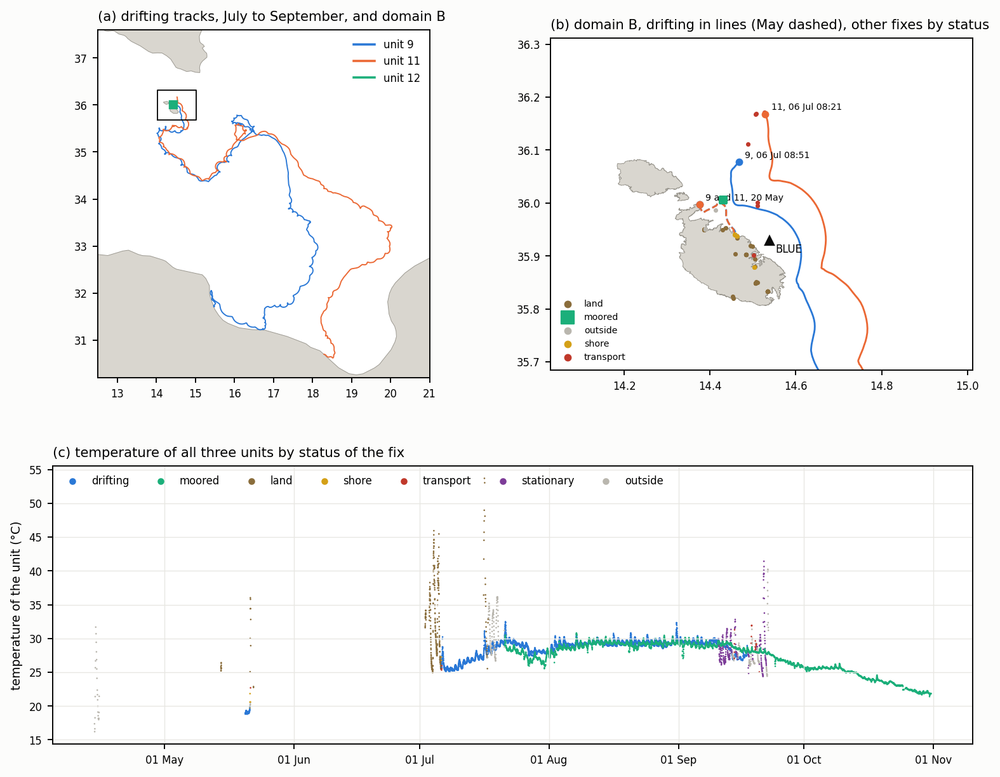

# The drifter record of 2026

*Received 9 November 2026 from Prof. Adam Gauci of the Oceanography Malta Research Group as three files, `SST_DATA_9.csv`, `SST_DATA_11.csv` and `SST_DATA_12.csv`, held at `data/raw/drifters/` and not versioned. Classified by `scripts/prepare_drifters_2026.py`, which writes `data/processed/drifters_2026.csv` and the figure `figures/drifters_2026_overview.png`.*

The three units transmit position and the temperature of their sensor at about 30 minutes. Two of them were released twice off the north and northeast coasts of Malta, on 20 May and on 6 July 2026, and are the first observation of Lagrangian transport available in the domain of the model. The third was held at a fixed point off the north coast from 21 July to the end of the record.

## 1. Contents

| | |
|---|---|
| Units | 9, 11 and 12 |
| Variables | latitude, longitude, temperature of the sensor, time in UTC and in local time |
| Sampling | 30 minutes, with about 1 per cent of intervals near 60 minutes |
| Span | unit 11 from 14 April, unit 9 from 14 May and unit 12 from 16 July, all three to the last transmission, 15 September, 22 September and 31 October 2026 |
| Fixes | 3956 for unit 9, 3644 for unit 11 and 4979 for unit 12 |

The files hold every transmission from switch-on to the last one, with no flag. Time stamps are unique, and the local time agrees with UTC under the offset given. Unit 11 transmits from 42.91 N, 2.66 W, in northern Spain, from 14 to 16 April, before it reached Malta. The temperature reaches 44 to 54 °C in fixes on land under the sun and is a reliable sign of a unit out of the water.

## 2. Classification of the fixes

Each fix is assigned one status by the tests below, applied in this order of precedence.

| Status | Test | Unit 9 | Unit 11 | Unit 12 |
|---|---|---|---|---|
| land | inside the coastline of the Maltese Islands ([coastline_dataset.md](coastline_dataset.md)) | 153 | 157 | 32 |
| shore | within 50 m of that coastline | 3 | 3 | 0 |
| stationary | positions over the next 12 h within 200 m, outside the Maltese coastline | 104 | 183 | 0 |
| transport | speed from the previous fix above 1.0 m/s | 24 | 7 | 0 |
| outside | before or after a deployment and passing the tests above | 104 | 62 | 118 |
| drifting | within a deployment and passing every test | 3568 | 3232 | 0 |
| moored | unit 12 from 21 July 08:54 UTC | 0 | 0 | 4829 |

A deployment is a bracket of time within which a unit was at sea, read from the record, and its drifting part runs from the first fix after the last failure of a test in the first six hours of the bracket to the last fix before the next failure. The threshold of 1.0 m/s lies above the largest speed of any drifting fix, 0.86 m/s, and below the 1.1 to 10.6 m/s of the units aboard the vessel. The threshold of 50 m from the coast removes the fixes of a grounding unit, which the cells of about 120 m of mesh v03 along the open coast do not resolve. The stationary test identifies units grounded on the Libyan coast, outside the coastline used for the land test.

*Drifting parts of the July deployments to their end on the coast of Libya, with domain B outlined (a). Domain B with the drifting parts of both deployments, May dashed, and the other fixes by status (b). Temperature of the sensor of all three units over the record, coloured by the status of each fix (c).*

## 3. Deployments

| Deployment | Drifting from (UTC) | First drifting position | Drifting to (UTC) | In domain B | End |
|---|---|---|---|---|---|
| 9, May | 20 May 07:58 | 36.00 N, 14.38 E | 21 May 09:57 | 26.0 h, 53 fixes | grounding at 35.94 N, 14.46 E |
| 11, May | 20 May 07:58 | 36.00 N, 14.38 E | 21 May 09:57 | 26.0 h, 53 fixes | grounding at 35.94 N, 14.46 E |
| 9, July | 6 July 08:51 | 36.08 N, 14.47 E | 17 September 14:22 | 55.5 h, 112 fixes | recovery off Libya |
| 11, July | 6 July 08:21 | 36.17 N, 14.53 E | 10 September 13:22 | 57.0 h, 115 fixes | stranding on the coast of Libya |

In May the two units were released together some 500 m off the north coast of Malta, drifted eastward away from it to some 3.7 km offshore and then southeastward back to it, at a median of 0.14 m/s, to within 50 m of the shore after 26 hours and some 10 km from the release point. Both then show temperatures rising to 29 to 36 °C and positions moving at road speed, the recovery of the units. The first fix of the deployment follows a gap of 5.7 days in transmission, so the time of release is not known more closely than that fix.

In July the units left Marsa, at the head of the Grand Harbour, aboard a vessel shortly after 06:20 UTC. Unit 11 drifts from 36.17 N and unit 9 from some 11 km to the south-southwest 30 minutes later. Both drifted southeastward, passed 8 to 13 km east of the harbour mouths and crossed the southern boundary of domain B after 55 to 57 hours, at a median of 0.25 to 0.27 m/s. They continued across the Ionian Sea into the Gulf of Sirte, where unit 11 grounded on 10 September and unit 9 was carried at vessel speed on 18 September. Within domain B the two July tracks run 6 to 12 km apart.

Unit 12 transmitted from land and from aboard a vessel between 16 and 19 July and from 21 July held a fixed point at 36.006 N, 14.431 E, some 5 km off the north coast. Its positions span 60 to 70 m over three months, consistent with a mooring, and its temperature falls smoothly from 29 to 22 °C over August to October with a diurnal range of 0.7 °C in the median. It records the sea surface temperature at a fixed point rather than transport.

## 4. Use for the validation of the model

The two deployments test the surface currents of the model in conditions that differ from each other. The May tracks lie along the north coast over one day, where the flow is steered by the coastline and the resolution of the mesh near the shore matters, and the July tracks cross the shelf east of the harbours over more than two days, in the region of the BLUE buoy, where the currents of the hindcast of 2025 were compared against the buoy ([hindcast_v03_first_week.md](hindcast_v03_first_week.md)). Neither enters the harbours. The two units of July, 6 to 12 km apart, also sample the spatial structure of the shelf flow.

The temperature of the drifting units and of unit 12 provides a measure of sea surface temperature in 2026, when the temperature sensor of the BLUE buoy is out of operation, and bears on the cold bias of 1.4 °C of the top layer found in the hindcast of 2025.

### Proposed run

A single three-dimensional run from 17 May to 9 July 2026 would cover both deployments with three days of spin-up before the first, in the working configuration of the hindcast (mesh v03, 20 stretched sigma layers, daily CMEMS current at the boundary, breakwaters closed by thin dams). At 0.38 h of simit-server per simulated day the 53 days cost about 20 hours on 12 cores, with some 85 GB of map output at 30 minutes. The same run would serve as the run of about two months required for the renewal of the harbours ([harbour_renewal_particles.md](harbour_renewal_particles.md), Section 9), with the drifters as a test of the Lagrangian transport on which the renewal estimate rests, and the BLUE record of current, wind, waves and pressure covers the window. The alternative, two short runs of 17 to 22 May and 3 to 9 July at some 2 hours each, would test the drifter tracks alone.

The run requires changes to the forcing chain. The CMEMS Mediterranean reanalysis does not extend to 2026, and the three-dimensional boundary fields would come from the analysis and forecast product, `cmems_mod_med_phy-{cur,sal,temp}_anfc_4.2km_P1D-m`, which the download script does not yet select. ERA5 covers the window.

The evaluation would follow the drifter validation of the model of the Stagnone di Marsala lagoon in western Sicily (StagnoneDT), on which the present configuration is built, with OpenDrift advecting particles in the top-layer currents of the model, interpolated onto a regular grid over the tracks, released at each observed position and scored against the observed track by separation distance and by the skill score of Liu and Weisberg (2011), the cumulative separation normalised by the cumulative length of the observed track. Releases repeated every 6 hours along each track would give some 14 scored segments of 24 hours, two in May and twelve in July. The same computation on the CMEMS surface currents alone would show whether the model improves on the field that forces its boundary. Since the drogue of the units is not known, a fraction of the wind speed added to the drift would be tested between 0 and 3 per cent, the range over which the drifter skill of StagnoneDT varied by deployment.

## 5. Matters for the group

1. The make and model of the units, the presence and depth of a drogue, and the depth of the temperature sensor, which set the windage to be applied and the layer of the model to which the temperature compares.
2. The purpose of the fixed position of unit 12 from 21 July, whether attached to a mooring or to a fish farm, and whether its record is intended as a temperature station.
3. The exact time of release on 20 May, since the record resumes at 07:58 UTC after a gap of 5.7 days.
4. Whether further deployments are planned, in particular inside the harbours, where the circulation of the model remains untested.

## References

Liu, Y. and Weisberg, R. H. (2011). Evaluation of trajectory modeling in different dynamic regions using normalized cumulative Lagrangian separation. Journal of Geophysical Research 116, C09013.
