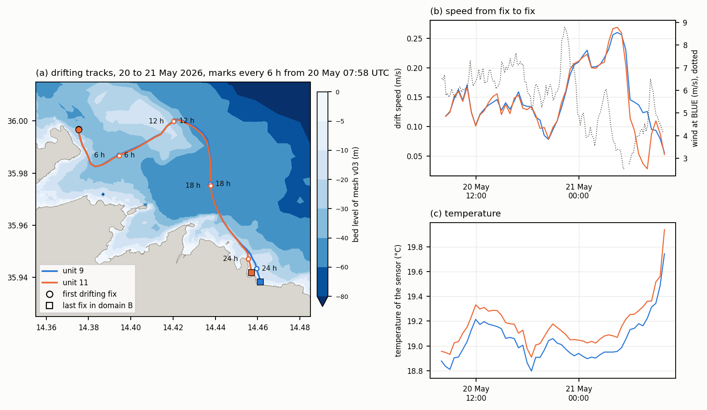
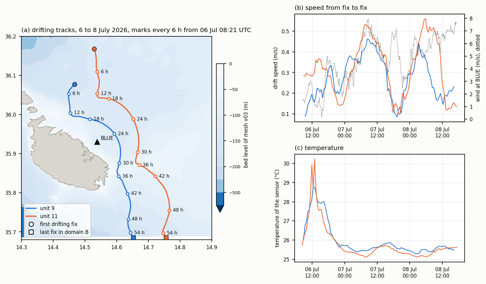
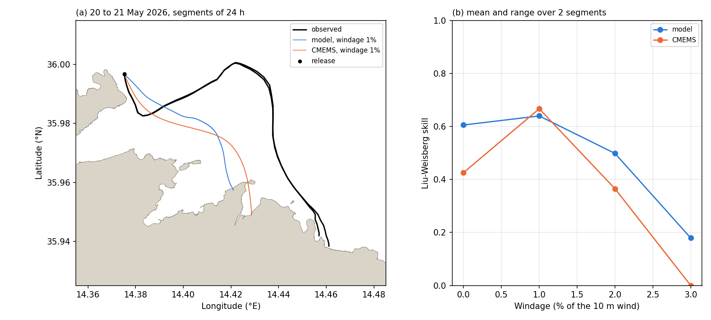
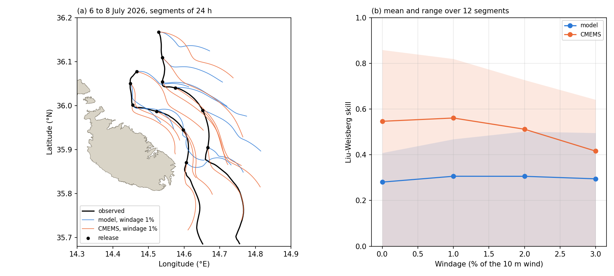
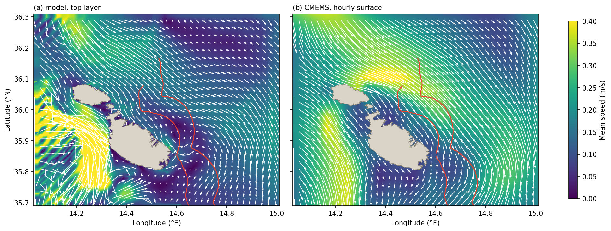
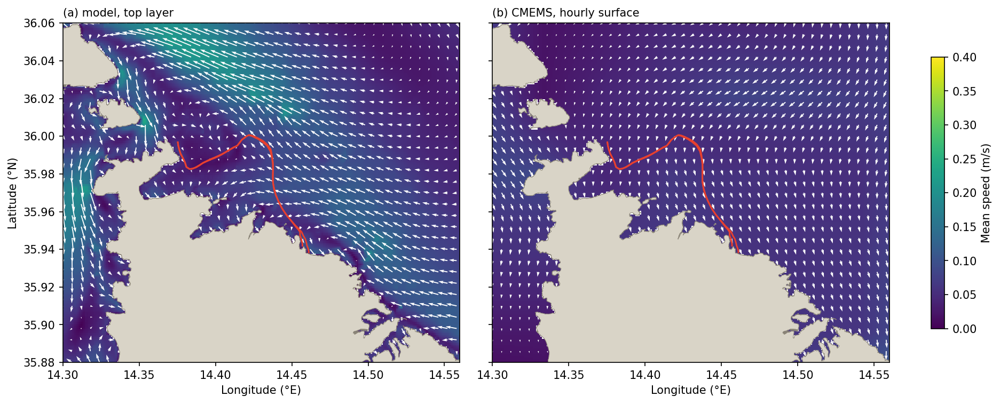

# The drifter record of 2026

*Received 31 October 2026 from Prof. Adam Gauci of the Oceanography Malta Research Group as three files, `SST_DATA_9.csv`, `SST_DATA_11.csv` and `SST_DATA_12.csv`, held at `data/raw/drifters/` and not versioned. Classified by `scripts/prepare_drifters_2026.py`, which writes `data/processed/drifters_2026.csv` and the figure `figures/drifters_2026_overview.png`.*

The three units transmit position and the temperature of their sensor at about 30 minutes. Two of them were released twice off the north and northeast coasts of Malta, on 20 May and on 6 July 2026, and are the first observation of Lagrangian transport available in the domain of the model. The third was held at a fixed point off the north coast from 21 July to the end of the record.

## 1. Contents

| | |
|---|---|
| Units | 9, 11 and 12 |
| Variables | latitude, longitude, temperature of the sensor, time in UTC and in local time |
| Sampling | 30 minutes, with about 1 per cent of intervals near 60 minutes |
| Span | unit 11 from 14 April, unit 9 from 14 May and unit 12 from 16 July, all three to the last transmission, 15 September, 22 September and 31 October 2026 |
| Fixes | 3956 for unit 9, 3644 for unit 11 and 4979 for unit 12 |

The files hold every transmission from switch-on to the last one, with no flag. Time stamps are unique, and the local time agrees with UTC under the offset given. Unit 11 transmits from 42.91 N, 2.66 W, in northern Spain, from 14 to 16 April, before it reached Malta. The temperature reaches 44 to 54 °C in fixes on land under the sun and is a reliable sign of a unit out of the water.

## 2. Classification of the fixes

Each fix is assigned one status by the tests below, applied in this order of precedence.

| Status | Test | Unit 9 | Unit 11 | Unit 12 |
|---|---|---|---|---|
| land | inside the coastline of the Maltese Islands ([coastline_dataset.md](coastline_dataset.md)) | 153 | 157 | 32 |
| shore | within 50 m of that coastline | 3 | 3 | 0 |
| stationary | positions over the next 12 h within 200 m, outside the Maltese coastline | 104 | 183 | 0 |
| transport | speed from the previous fix above 1.0 m/s | 24 | 7 | 0 |
| outside | before or after a deployment and passing the tests above | 104 | 62 | 118 |
| drifting | within a deployment and passing every test | 3568 | 3232 | 0 |
| moored | unit 12 from 21 July 08:54 UTC | 0 | 0 | 4829 |

A deployment is a bracket of time within which a unit was at sea, read from the record, and its drifting part runs from the first fix after the last failure of a test in the first six hours of the bracket to the last fix before the next failure. The threshold of 1.0 m/s lies above the largest speed of any drifting fix, 0.86 m/s, and below the 1.1 to 10.6 m/s of the units aboard the vessel. The threshold of 50 m from the coast removes the fixes of a grounding unit, which the cells of about 120 m of mesh v03 along the open coast do not resolve. The stationary test identifies units grounded on the Libyan coast, outside the coastline used for the land test.

*Drifting parts of the July deployments to their end on the coast of Libya, with domain B outlined (a). Domain B with the drifting parts of both deployments, May dashed, and the other fixes by status (b). Temperature of the sensor of all three units over the record, coloured by the status of each fix (c).*

## 3. Deployments

| Deployment | Drifting from (UTC) | First drifting position | Drifting to (UTC) | In domain B | End |
|---|---|---|---|---|---|
| 9, May | 20 May 07:58 | 36.00 N, 14.38 E | 21 May 09:57 | 26.0 h, 53 fixes | grounding at 35.94 N, 14.46 E |
| 11, May | 20 May 07:58 | 36.00 N, 14.38 E | 21 May 09:57 | 26.0 h, 53 fixes | grounding at 35.94 N, 14.46 E |
| 9, July | 6 July 08:51 | 36.08 N, 14.47 E | 17 September 14:22 | 55.5 h, 112 fixes | recovery off Libya |
| 11, July | 6 July 08:21 | 36.17 N, 14.53 E | 10 September 13:22 | 57.0 h, 115 fixes | stranding on the coast of Libya |

In May the two units were released together some 500 m off the north coast of Malta, drifted eastward away from it to some 3.7 km offshore and then southeastward back to it, at a median of 0.14 m/s, to within 50 m of the shore after 26 hours and some 10 km from the release point. Both then show temperatures rising to 29 to 36 °C and positions moving at road speed, the recovery of the units. The first fix of the deployment follows a gap of 5.7 days in transmission, so the time of release is not known more closely than that fix.

*Drifting tracks of units 9 and 11 from 20 May 07:58 to 21 May 09:57 UTC over the bed levels of mesh v03, with the elapsed time marked every 6 hours (a), the speed of each unit from fix to fix with the wind at the BLUE buoy (b), and the temperature of the sensors (c). Drawn by `scripts/figure_drifters_2026.py`.*

The two units remain within 50 m of each other in the median and 560 m at most, so that the May deployment amounts to one trajectory sampled twice. Their speed rises from 0.1 to 0.26 m/s overnight as they turn south toward the coast, while the wind at the buoy falls from 9 to 3 m/s.

In July the units left Marsa, at the head of the Grand Harbour, aboard a vessel shortly after 06:20 UTC. Unit 11 drifts from 36.17 N and unit 9 from some 11 km to the south-southwest 30 minutes later. Both drifted southeastward, passed 8 to 13 km east of the harbour mouths and crossed the southern boundary of domain B after 55 to 57 hours, at a median of 0.25 to 0.27 m/s. They continued across the Ionian Sea into the Gulf of Sirte, where unit 11 grounded on 10 September and unit 9 was carried at vessel speed on 18 September. Within domain B the two July tracks run 6 to 12 km apart.

*Drifting tracks of units 9 and 11 from 6 July 08:21 UTC to their crossing of the southern boundary of domain B on 8 July, as in the figure of May, with the BLUE buoy.*

The speed of both units varies between 0.1 and 0.56 m/s with maxima some 21 hours apart, on the morning of 7 July and early on 8 July, which coincide with the maxima of the wind at the buoy and lie close to the inertial period of 20.5 hours at this latitude, so that the record alone does not separate the two. The temperature of the sensors rises from 26 to 29 and 30 °C around midday of 6 July under a wind of 1 to 2 m/s and returns to 25.5 °C as the wind rises, a diurnal warming of the surface layer under calm conditions which suggests that the sensor lies within the uppermost decimetres of the water.

Unit 12 transmitted from land and from aboard a vessel between 16 and 19 July and from 21 July held a fixed point at 36.006 N, 14.431 E, some 5 km off the north coast. Its positions span 60 to 70 m over three months, consistent with a mooring, and its temperature falls smoothly from 29 to 22 °C over August to October with a diurnal range of 0.7 °C in the median. It records the sea surface temperature at a fixed point rather than transport.

## 4. Use for the validation of the model

The two deployments test the surface currents of the model in conditions that differ from each other. The May tracks lie along the north coast over one day, where the flow is steered by the coastline and the resolution of the mesh near the shore matters, and the July tracks cross the shelf east of the harbours over more than two days, in the region of the BLUE buoy, where the currents of the hindcast of 2025 were compared against the buoy ([hindcast_v03_first_week.md](hindcast_v03_first_week.md)). Neither enters the harbours. The two units of July, 6 to 12 km apart, also sample the spatial structure of the shelf flow.

The temperature of the drifting units and of unit 12 provides a measure of sea surface temperature in 2026, when the temperature sensor of the BLUE buoy is out of operation, and bears on the cold bias of 1.4 °C of the top layer found in the hindcast of 2025.

### Runs for the deployments

Each deployment is covered by its own three-dimensional run in the working configuration of the hindcast (mesh v03, 20 stretched sigma layers, daily CMEMS current at the boundary, breakwaters closed by thin dams), with three days of spin-up before the first drifting fix.

| Run | Case | Window (UTC) | Simulated days | FM on simit-server, 12 cores |
|---|---|---|---|---|
| May | `v03_3d20s_0517_0522_uv_thd_2026` | 17 May 00:00 to 22 May 00:00, 2026 | 5 | 2.42 h |
| July | `v03_3d20s_0703_0709_uv_thd_2026` | 3 July 00:00 to 9 July 00:00, 2026 | 6 | 1.87 h |

*Wall-clock times of the two runs made side by side on the first socket, with a run of 8 cores of another project on the second, against 0.38 h per simulated day measured on the working configuration with the server otherwise idle. The map output at 30 minutes occupies 7.6 and 9.1 GB.*

The CMEMS Mediterranean reanalysis does not extend to 2026, so the boundary fields come from the analysis and forecast product, the sea surface height at 15 minutes and the daily currents, salinity and temperature (`cmems_mod_med_phy-{cur,sal,tem}_anfc_4.2km_P1D-m`), selected in `scripts/download_cmems_hindcast.py` by `--product anfc`. The hourly surface currents of the same product (`cmems_mod_med_phy-cur_anfc_4.2km-2D_PT1H-m`) are downloaded with `--surface-hourly` as the reference field of the evaluation. ERA5 covers both windows, and the BLUE record of current, wind, waves and pressure covers both.

The runs of the renewal of the harbours, in winter and in summer, are separate and longer ([harbour_renewal_particles.md](harbour_renewal_particles.md), Section 9).

## 5. Skill of the surface currents

### Method

The evaluation follows the drifter validation of the model of the Stagnone di Marsala lagoon in western Sicily (StagnoneDT), on which the present configuration is built, and is carried out by `scripts/drifter_skill_2026.py`. The top-layer currents of each run, merged from the partitioned map output by `scripts/extract_surface_map.py`, and the hourly surface currents of the CMEMS analysis-forecast product are interpolated onto one regular grid, of 0.001° (about 100 m) for May and 0.002° (about 200 m) over domain B for July, with the land mask of mesh v03 for both, so that the two sources differ in the current alone. The 10 m wind of ERA5 is interpolated onto the same grid.

OpenDrift advects one particle from each release, at an observed fix every 6 hours along each track, for 24 hours, with a fourth-order Runge-Kutta step of 300 s and no random walk. This gives 14 segments, one for each unit in May and six for each unit in July. Each segment is scored on the output times of OpenDrift, at 15 minutes, against the observed fixes interpolated linearly in time, by the separation from the observed position after 6, 12 and 24 hours and by the skill score of Liu and Weisberg (2011). That score is one minus the sum over the segment of the separation divided by the length of the observed track travelled to that time, set to zero where the sum exceeds one, so that 1 is a perfect track and 0 a track that departs as fast as the drifter moves. A fraction of the wind speed (windage) is added to the drift at 0, 1, 2 and 3 per cent, since the drogue of the units is not known. The metrics of every segment are written to `data/processed/drifter_skill_2026.csv`.

### Skill by deployment

| Deployment | Field | Windage 0 | 1 % | 2 % | 3 % | Separation at 24 h, 1 % (km) | Simulated over observed path, 1 % |
|---|---|---|---|---|---|---|---|
| May, 2 segments | model | 0.61 | **0.64** | 0.50 | 0.18 | 3.6 | 0.49 |
| | CMEMS | 0.43 | **0.67** | 0.37 | 0.00 | 2.6 | 0.60 |
| July, 12 segments | model | 0.28 | **0.31** | 0.31 | 0.30 | 15.2 | 0.55 |
| | CMEMS | 0.55 | **0.56** | 0.51 | 0.42 | 6.4 | 0.85 |

*Mean Liu-Weisberg skill over the segments of each deployment, with the separation at 24 hours and the ratio of the simulated to the observed path length, both as means over the segments at a windage of 1 per cent. The observed tracks cover 13.3 km in 24 hours in May and 26.9 km in July, in the mean.*

*Observed tracks of units 9 and 11 on 20 and 21 May, with the segments of 24 hours simulated in the currents of the model and of CMEMS at the windage of best mean skill for the model (a), and the mean and range of the Liu-Weisberg skill over the segments against the windage (b).*

In May the two fields score alike at 1 per cent, 0.64 for the model and 0.67 for CMEMS. Neither carries the units away from the coast to the north-east and back, and the simulated particles reach the shore 3 to 4 km west of the grounding point of the units. Without wind the model scores 0.61 and CMEMS 0.43. Two segments of one track sampled twice support no more than this comparison.

*As for May, for units 9 and 11 from 6 to 8 July.*

In July the model scores 0.31 at 1 per cent and CMEMS 0.56, the model falling below CMEMS in 10 of the 12 segments and equal to it, at zero, in one, and the separation after 24 hours is 15 km for the model against 6 km for CMEMS. The windage changes the skill of the model by 0.03 at most, so that the departure lies in the current and not in the treatment of the wind.

### Velocity along the tracks

| Deployment | Source | Fix intervals | Mean eastward (m/s) | Mean northward (m/s) | Mean speed (m/s) |
|---|---|---|---|---|---|
| May | observed | 104 | 0.08 | −0.07 | 0.15 |
| | model, top layer | 104 | 0.00 | −0.02 | 0.06 |
| | CMEMS | 104 | 0.00 | −0.04 | 0.06 |
| July | observed | 225 | 0.09 | −0.24 | 0.29 |
| | model, top layer | 222 | 0.05 | −0.06 | 0.11 |
| | CMEMS | 222 | 0.06 | −0.19 | 0.24 |

*Velocity of the units from fix to fix, at 30 minutes, against the current of each field interpolated to the midpoint of each interval in space and time. Three intervals of July lie south of the grid.*

In July the units drift southward at 0.24 m/s in the mean, which CMEMS reproduces at 0.19 m/s, while the top layer of the model carries 0.06 m/s southward and a mean speed of 0.11 m/s, some two fifths of the observed. In May both fields carry less than half of the observed speed, and a windage of 1 per cent of the mean eastward wind of 3.7 m/s supplies about half of the observed eastward drift.

*Mean surface current from 6 July 08:21 to 8 July 17:21 UTC, the drifting part of the July deployment, in the top layer of the model (a) and in the hourly surface field of CMEMS (b), with the observed tracks in red.*

Over the drifting part of the July deployment CMEMS carries a south-eastward current of 0.3 to 0.4 m/s along the north of Malta and Gozo that turns south east of Malta, where the units drift, and a southward current of similar strength west of Malta. The top layer of the model holds a weaker eastward current north of the islands and less than 0.1 m/s over most of the area east and south-east of Malta. West and south-west of Malta it holds currents above 0.4 m/s in a chequered pattern over the slope, the spurious top-layer currents on refinement transitions found in the hindcast of 2025 ([hindcast_v03_first_week.md](hindcast_v03_first_week.md)).

*As for July, over the drifting part of the May deployment, 20 May 07:58 to 21 May 09:57 UTC.*

The shelf current of CMEMS enters the model through the sea level, by the weakly reflective (Riemann) boundary, and through the daily current as an advective velocity at the boundary, and the comparison suggests that the interior of domain B retains little of it at the surface in July. Whether the loss lies in the forcing at the boundary, in the three days of spin-up from rest, or in the vertical structure of the top layer of 1 per cent of the column is not resolved by these two runs. The renewal of the harbours rests on the currents inside and next to the harbours rather than on the shelf flow east of Malta, which the drifters sample, so that the result bears on the renewal runs through their exchange with the shelf at the mouths.

## 6. Matters for the group

1. The make and model of the units, the presence and depth of a drogue, and the depth of the temperature sensor, which set the windage to be applied and the layer of the model to which the temperature compares.
2. The purpose of the fixed position of unit 12 from 21 July, whether attached to a mooring or to a fish farm, and whether its record is intended as a temperature station.
3. The exact time of release on 20 May, since the record resumes at 07:58 UTC after a gap of 5.7 days.
4. Whether further deployments are planned, in particular inside the harbours, where the circulation of the model remains untested.

## References

Liu, Y. and Weisberg, R. H. (2011). Evaluation of trajectory modeling in different dynamic regions using normalized cumulative Lagrangian separation. Journal of Geophysical Research 116, C09013.
