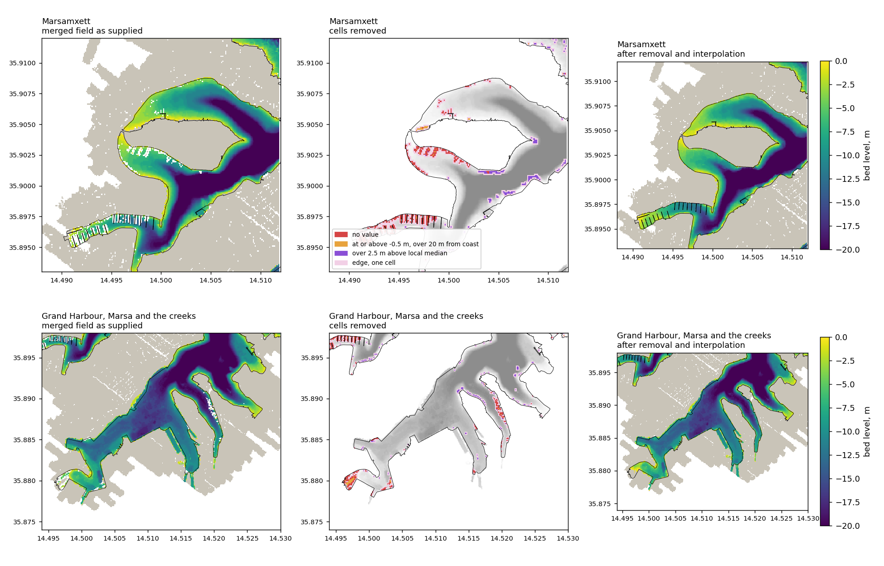
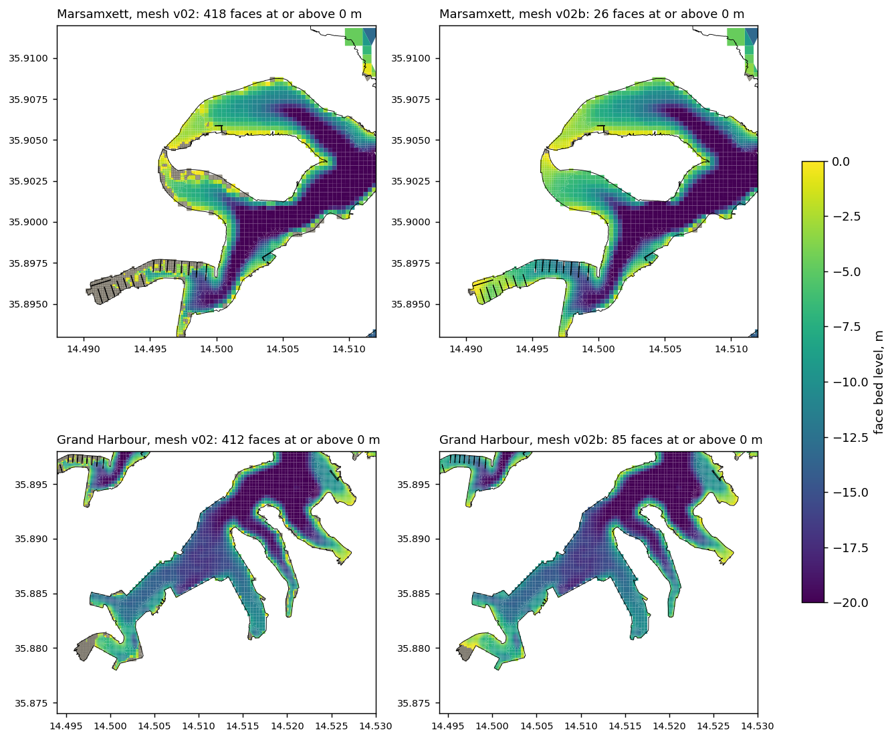

# Bed levels in the harbours and mesh version 02b

*Raster cleaned by `scripts/clean_harbour_bathymetry.py`, node levels resampled by `scripts/resample_mesh_bathymetry.py`, figures by the first script with `--figure` and by `scripts/figure_mesh_bathymetry_cleaning.py`. Products in `data/processed/`, regenerated by the scripts. Versions 02b and outer01b share the geometry of versions 02 and outer01 and differ from them in the node bed levels alone.*

## 1. Returns from pontoons and vessels

The merged 10 m field of 4036_MEPA ([mepa_4036_dataset.md](mepa_4036_dataset.md)) holds, along the marina pontoons of Ta' Xbiex, Msida, Pietà and the creeks of the Grand Harbour, rows of cells without a value and rows of values near or above zero in water several metres deep. Both are aligned with the piers. They are read here as the LiDAR survey recording the deck of a floating pontoon or the hull of a moored vessel, or no usable return, in place of the seabed. The reading is consistent with the layout of the pontoons and remains to be confirmed against imagery.

Within a box enclosing both harbours, 14.480 to 14.540 E and 35.870 to 35.915 N, a water cell is removed when it carries no value, when its level is at or above −0.5 m more than 20 m from the coastline, or when it stands more than 2.5 m above the median of the valid water cells in a window of 7 by 7 cells, again more than 20 m from the coastline. The removed set is widened by one cell, since the edge of a deck or hull yields mixed returns. The removed cells are filled by inverse-distance interpolation from the remaining water cells, land cells being excluded as sources. The limits are working values. The distance from the coastline protects the shallow fringe along the quays, which a window spanning the fringe and the channel would otherwise read as a spike, and the limit of 2.5 m spares the break of slope at the edge of the dredged channels, which a limit of 1.5 m removed.

| Criterion | Cells | Share of harbour water |
|---|---|---|
| No value | 904 | 1.2 % |
| At or above −0.5 m, beyond 20 m from the coast | 108 | 0.1 % |
| More than 2.5 m above the local median | 561 | 0.8 % |
| Edge, one cell | 3 823 | 5.1 % |
| All | 5 396 | 7.2 % |

The level of the removed cells that carried a value changes by a median of −0.80 m, between −6.85 and +2.00 m for 90 per cent of them. Harbour water cells at or above zero fall from 579 to 508, those remaining lying within 20 m of the coast.

*Bed level of the merged field as supplied (left), cells removed by criterion over the field in grey (centre) and the field after removal and interpolation (right), for Marsamxett (top) and the Grand Harbour (bottom). Levels at or above zero in light grey, no value in white.*

## 2. Sampling of the mesh

The node levels of version 02 are bilinear samples of the merged field, and a sample is without value as soon as one of the four surrounding cells is a gap or lies outside the field. Such a node took the EMODnet level, whose cells of some 115 m inside the harbours are land. Inside the harbour box 710 nodes received EMODnet levels, 662 of them at or above zero with a median of +5.8 m and up to +15.4 m. Together with the pontoon returns this left 717 harbour faces at or above zero, the whole marina basin at the head of Msida Creek among them.

The mesh is now sampled on a second field in which, in addition, land cells within 30 m of water take the level of the nearest water cell. A node on the coastline then samples the bed beside the quay wall rather than the level of the quay, and a node near the shore no longer meets a gap. Cells farther from water keep no value, and where the field has none, outside the MEPA coverage, the node keeps its level, so that the EMODnet levels offshore are unchanged.

| Quantity | Version 02 | Version 02b |
|---|---|---|
| Harbour faces with mean bed at or above 0 m | 717 | 110 |
| of which in the view of Marsamxett below | 418 | 26 |
| of which in the view of the Grand Harbour below | 412 | 85 |
| Nodes changed by more than 1 cm | | 3 277 of 26 712 |
| Faces outside the harbours changed by more than 0.5 m | | 537 of 17 662 |

The faces outside the harbours that change are coastal faces elsewhere in domain B, whose shore nodes no longer sample the topography. The same 3 277 nodes change in the outer mesh, whose cells inside domain B coincide with version 02.

*Face bed level, the mean of the node levels as computed under bedLevType = 3, in Marsamxett (top) and the Grand Harbour (bottom) for version 02 (left) and version 02b (right). Faces at or above zero in grey.*

The faces that remain at or above zero lie mostly at the head of Marsa, where the survey itself returns levels near zero over the inner basin. Whether these are the bed or a further class of return is not established.

## 3. Consequences for the results to date

The sweep of the long wave ([longwave_sweep.md](longwave_sweep.md)) and the interactive maps were computed on the outer mesh with the levels of version 02, so with the marina basin at the head of Msida Creek dry and the station at the head placed 261 m from the intended point. The responses at the heads of Msida and Pietà Creeks, and to a lesser degree at Marsa, are expected to change on version 02b, and the sweep is to be repeated on outer01b before those values are used. The response at Senglea and off the harbours, where the bed is unchanged, is not expected to change materially.

## 4. Matters open

1. Confirmation of the pontoon and vessel returns against imagery or the pontoons mapped in OpenStreetMap, which would also fix the three limits.
2. The bed at the head of Marsa.
3. The removed cells mark the footprint of pontoons and moored vessels at the time of the survey, and serve as a first map of the floating structures, whose effect on the surface flow can be represented in D-Flow FM through a forced ice cover of prescribed thickness and area fraction (User Manual, Sections 12.14 and 16). The fixed piers on piles can be represented by the rigid vegetation model of cylinders (Section 13.4).
