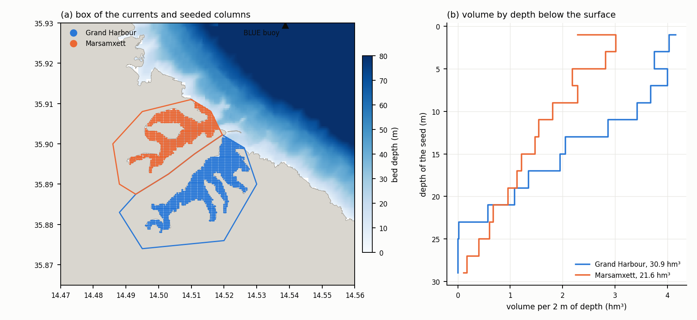
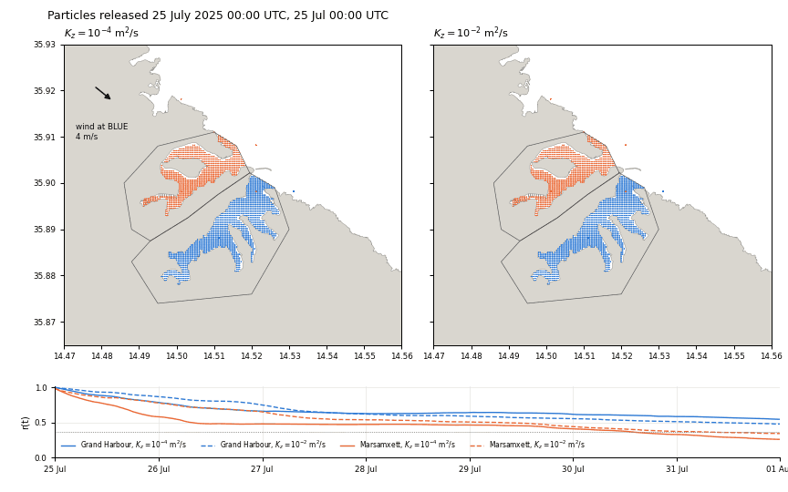
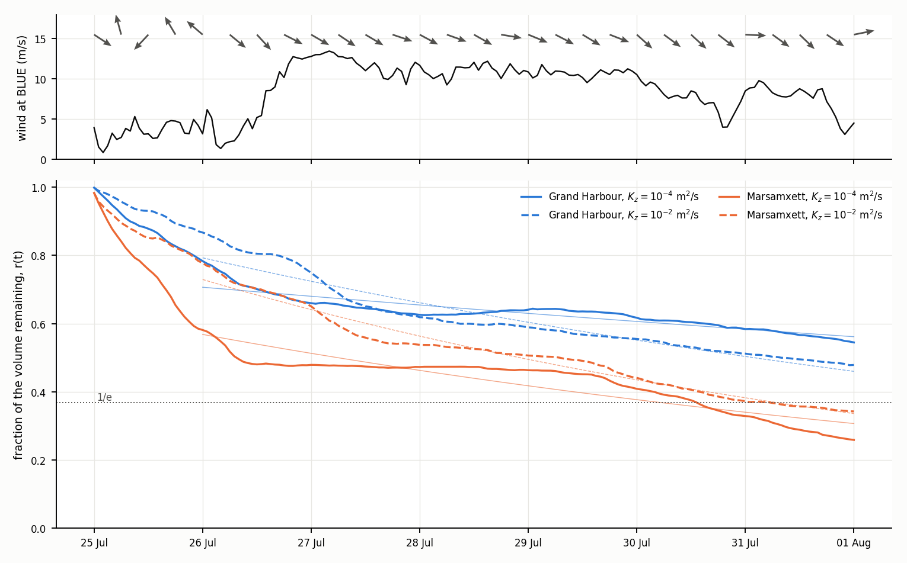
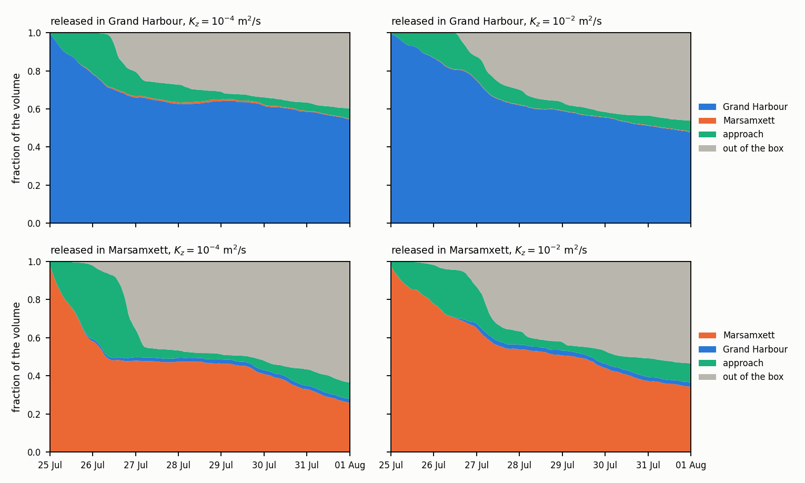
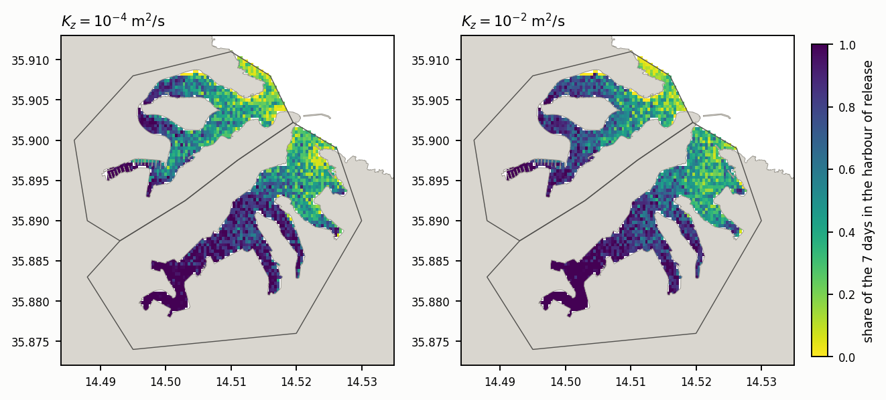

# Renewal of the harbours by particle tracking, 25 July to 1 August 2025

*Currents extracted by `scripts/extract_harbour_currents_3d.py` on simit-server, particles run and summarised by `scripts/renewal_opendrift.py`, figures drawn by `scripts/figure_harbour_renewal.py`. The hydrodynamic case is the working configuration of [hindcast_v03_first_week.md](hindcast_v03_first_week.md), `v03_3d20s_0722_0801_uv_thd`. Particle files under `outputs/renewal/`, regenerated by the scripts and not versioned.*

The renewal of the water of the Grand Harbour and of Marsamxett is the principal question of the study ([research_question_and_literature.md](research_question_and_literature.md)), and its computation requires a hydrodynamic run long enough for most of the water of each harbour to be replaced. The present computation applies particle tracking to the one week of three-dimensional currents available, in order to estimate the time scales of renewal and from them the length and cost of that run. The results are preliminary, since one week under one wind regime is shorter than the time scales it estimates for the Grand Harbour, and the vertical diffusivity is a working value set at two bounds.

## Summary

**Work carried out.** The three-dimensional currents of the working hindcast were interpolated onto a grid of about 40 m and 18 fixed depths around both harbours, and 10 870 particles filling the water column of the two harbours were released on 25 July 2025 00:00 UTC and followed for seven days with OpenDrift, at a vertical diffusivity of 10⁻⁴ and of 10⁻² m²/s (Sections 2 and 3). Three properties of OpenDrift 1.14 bear on the configuration and are stated in Section 4.

**Results.** After seven days 26 to 34 per cent of the volume of Marsamxett and 48 to 55 per cent of that of the Grand Harbour remain in the harbour of release (Section 6). Marsamxett reaches the e-folding fraction of 1/e after 5.6 to 6.3 days, and the Grand Harbour does not reach it within the week. An exponential fitted after the first day gives e-folding times of 8 to 10 days for Marsamxett and of 11 to 26 days for the Grand Harbour, and extrapolated, 95 per cent renewal after some 22 to 25 and 31 to 70 days respectively. The decay proceeds in episodes separated by days of near constancy, which places the uncertainty of the extrapolation at about a factor of two. The heads of the inlets retain their water through the week, among them Marsa, French Creek and Dockyard Creek in the Grand Harbour and Msida Creek and Pietà Creek in Marsamxett (Section 8), and the exchange between the two harbours is 2 per cent of the volume of Marsamxett or less (Section 7).

**Requirements of the renewal run.** A hydrodynamic run of about two months would measure the e-folding time of both harbours directly and allow releases repeated every ten days, at some 24 hours of simit-server on 12 cores and about 100 GB of map output (Section 9). The vertical diffusivity of the turbulence model, written to the map output, would replace the two bounds used here.

## 1. Measures of renewal

A volume V₀ of water is marked inside a harbour at time t₀. The remaining fraction r(t) is the part of V₀ found inside the same harbour at time t,

r(t) = V_inside(t) / V₀,

which starts at 1 and falls as harbour water leaves and is replaced by water from outside. Water that leaves and later returns counts again on return, so r(t) need not decrease monotonically.

Three time scales follow from r(t).

1. The e-folding time τ, at which r(t) first falls below 1/e ≈ 0.37. For a well-mixed basin exchanging with an unlimited sea at a constant rate, r(t) = exp(−t/τ) and τ is the ratio of volume to exchange flow.
2. The mean residence time of Takeoka (1984), θ = ∫₀^∞ r(t) dt, the average time a marked parcel spends inside the basin before it leaves for good. Over a window of length W the integral is truncated at W and is a lower bound on θ.
3. The times t₉₅ and t₉₉ at which 95 and 99 per cent of V₀ have been renewed, r = 0.05 and 0.01. With an exponential r(t) = A exp(−t/τ_fit) they are t = τ_fit ln(A/r).

The exponential is fitted to ln r(t) by least squares after the first day, which leaves out the fast initial exchange of the water nearest the mouth, and its τ_fit and t₉₅ and t₉₉ extrapolate beyond the window under the assumption that the rate of the week persists.

Each particle carries the volume of its share of the water column, so r(t) is computed as the summed volume of the particles of a harbour that lie inside its polygon at time t, divided by their total volume. A particle that leaves the box of the currents is deactivated by OpenDrift and counted as renewed.

## 2. Hydrodynamic input

| Element | Setting |
|---|---|
| Case | `v03_3d20s_0722_0801_uv_thd`, mesh v03, 20 stretched sigma layers, daily CMEMS current at the boundary, breakwaters closed by thin dams ([hindcast_v03_first_week.md](hindcast_v03_first_week.md)) |
| Source fields | map output at 30 minutes, three velocity components at the layer centres, water level and bed level |
| Box | 14.470 to 14.560 E, 35.865 to 35.930 N, about 8 by 7 km, both harbours and some 3 km of the approach |
| Horizontal grid | 0.0004 degrees, about 36 by 44 m, 226 by 163 points of which 14 523 wet |
| Vertical grid | 18 fixed depths below the free surface, 0.5, 1, 2, 3, 4, 6, 8, 10, 13, 16, 20, 25, 30, 40, 50, 60, 80 and 100 m |
| Window | 25 July 2025 00:00 to 1 August 2025 00:00 UTC, 337 instants, after the three days of spin-up of the hindcast |
| File | CF names read by the generic reader of OpenDrift, 795 MB, written in about one minute on simit-server |

Each face of the mesh is interpolated onto the grid as in the harbour sections of the hindcast, and each depth d below the surface of a column of depth H maps to σ = 1 − d/H, so that the vertical interpolation is linear in σ between the layer centres and identical in every column. Above the centre of the top layer the top layer applies. Grid points on land take the values of the nearest wet point, since zero velocity and zero depth on land would make the bilinear interpolation of OpenDrift taper both toward the shore across one grid cell (Section 4).

The box keeps some 3 km of the approach so that water leaving a harbour on the ebb of the exchange can return on the next reversal before it leaves the box. Its edge is the outer limit of the computation, and a particle reaching it is not followed further.

## 3. Release and transport of the particles

*Bed depth of the box of the currents with the polygons of the two harbours and the seeded water columns (a), and the seeded volume of each harbour per 2 m of depth below the surface (b). The polygons close each harbour at its mouth and run over land elsewhere, the ridge of Valletta and Floriana dividing the two, and only wet grid points are seeded. The BLUE buoy lies at the northern edge of the box.*

Every wet grid point at least 1 m deep inside a harbour polygon is seeded with five particles, at the centres of five equal parts of the column, 0.1, 0.3, 0.5, 0.7 and 0.9 of the depth below the surface, each standing for one fifth of the column volume. The Grand Harbour holds 1278 seeded columns and 30.9 hm³, Marsamxett 895 columns and 21.6 hm³, at a grid cell of 1600 m². The Grand Harbour holds more of its volume between 10 and 20 m of depth, where the main channel of the harbour lies.

| Parameter | Value | Basis |
|---|---|---|
| Model | OpenDrift 1.14.9, `OceanDrift` | passive particles |
| Particles | 6395 in the Grand Harbour, 4475 in Marsamxett | five per column |
| Release | 25 July 2025 00:00 UTC, followed to 1 August 00:00 | the validation window of the hindcast |
| Horizontal advection | fourth-order Runge-Kutta, step 300 s | |
| Vertical advection | none | Section 4 |
| Horizontal diffusivity Kh | 0.1 m²/s | working value for the motions below a grid of some 40 m |
| Vertical diffusivity Kz | 10⁻⁴ and 10⁻² m²/s, constant | working bounds, Kz not in the map output |
| Vertical random walk | step 60 s | |
| Coast and bed | particle returned to its previous position | |
| Wind drift | none | particles move with the modelled current alone |
| Output | hourly | |

The two values of Kz bound the vertical mixing that the k-ε model of the hindcast is expected to produce in a stratified summer harbour. Under 10⁻⁴ m²/s a particle spreads by about 11 m in the vertical in a week, so that it remains in the layer of release and follows the vertical structure of the exchange flow. Under 10⁻² m²/s the mixing time H²/Kz of a column of 20 m is about half a day, and particles sample the whole column within a day.

At release 175 particles, 1.6 per cent, fall on grid points that the interpolated land mask of OpenDrift places on land and are moved by OpenDrift to the nearest water, some of them outside the harbour polygon, which sets r(0) at 0.999 for the Grand Harbour and 0.983 for Marsamxett.

## 4. Configuration of OpenDrift 1.14

Three properties of the model, each found by a test release, determine the configuration of Section 3.

**Vertical velocity.** The vertical velocity of FM, interpolated from the σ layers onto a grid of 40 m at fixed depths, is no longer consistent with the interpolated horizontal components. In a test of 6 hours it carried a tenth of the particles to the surface, where they remain wherever the interpolated velocity is upward and are then held against the shore by the surface current, some 97 per cent of the particles still in the harbours after four days. Vertical advection is therefore left out, and particles move vertically by the random walk of the mixing alone. The option `--vertical-advection` of `renewal_opendrift.py` restores it.

**Diffusivities.** OpenDrift 1.14 reads both diffusivities as environment variables. The configuration key `drift:horizontal_diffusivity` is accepted without error and not applied, so two runs differing in it alone give identical trajectories, and the fallback value of the vertical diffusivity does not reach the profile used by the random walk. Both are set as constants of the environment, `environment:constant:horizontal_diffusivity` and `environment:constant:ocean_vertical_diffusivity`, with `vertical_mixing:diffusivitymodel = environment`, and the spread of a test release then follows the expected √(2Kt).

**Land values of the input grid.** With zero velocity and depth on land, the bilinear interpolation of the reader tapers both across the last grid cell before the shore, and particles entering that band come to rest on a bed near the surface. In that configuration the median displacement fell to 24 m per day and r(t) held a spurious plateau. With land filled from the nearest wet point (Section 2) the median displacement is 290 to 340 m per day and fewer than 1 per cent of the active particles move less than 5 m in a day.

## 5. Particles over the week

*Positions of the particles every two hours from 25 July 00:00 to 1 August 00:00 UTC under Kz = 10⁻⁴ m²/s (left) and 10⁻² m²/s (right), blue for those released in the Grand Harbour and orange for those released in Marsamxett, at all depths. The arrow gives the direction toward which the wind at the BLUE buoy blows, and the lower panel the remaining fraction r(t) of Section 6 with the instant of the frame. Particles reaching the edge of the box leave the computation.*

Over 25 July, under weak and variable wind, the water of Marsamxett leaves northwestward along the shore of Sliema and that of the Grand Harbour southeastward. From the afternoon of 26 July the northwesterly carries both plumes southeastward along the coast past Rinella toward the edge of the box, and under Kz = 10⁻⁴ m²/s the main channel of the Grand Harbour empties while its creeks and Marsa keep their particles. The inner reaches of both harbours keep their particles through the week, and exchange between the two harbours across their adjacent mouths is small.

## 6. Remaining fraction and time scales

*Hourly wind speed at the BLUE buoy, with arrows every six hours toward the direction in which it blows (top), and the remaining fraction r(t) of each harbour under both values of Kz, with the exponential fitted after the first day as a thin line (bottom).*

| Harbour | Kz (m²/s) | r(7 d) | τ, 1/e reached (d) | θ truncated at 7 d (d) | τ_fit (d) | t₉₅ (d) | t₉₉ (d) |
|---|---|---|---|---|---|---|---|
| Marsamxett | 10⁻⁴ | 0.26 | 5.6 | 3.3 | 9.7 | 24.7 | 40.3 |
| Marsamxett | 10⁻² | 0.34 | 6.3 | 3.9 | 7.7 | 21.7 | 34.2 |
| Grand Harbour | 10⁻⁴ | 0.55 | not reached | 4.7 | 26.1 | 70.1 | 112 |
| Grand Harbour | 10⁻² | 0.48 | not reached | 4.6 | 11.0 | 31.4 | 49.2 |

*τ_fit, t₉₅ and t₉₉ extrapolate the exponential of the days 1 to 7 beyond the window.*

Marsamxett renews faster than the Grand Harbour under both diffusivities, with two thirds of its volume. Under Kz = 10⁻⁴ m²/s Marsamxett loses 42 per cent of its volume in the first day, against 22 per cent for the Grand Harbour. The water of the middle of its column leaves first, and that of the top and bottom fifths remains longest (Section 8).

The decay is episodic. Under Kz = 10⁻⁴ m²/s the remaining fraction of both harbours falls mainly over 25 July and the first half of 26 July, under weak wind of 1 to 6 m/s, and again after 29 July as the wind weakens, and it stays nearly constant from the second half of 26 July to 29 July under the northwesterly of 10 to 13 m/s. Under Kz = 10⁻² m²/s the largest fall of both harbours occurs on 27 July, at the height of the wind. The difference suggests that the timing of renewal depends on how the wind-driven exchange at the mouth is distributed over the column, which the vertical diffusivity controls. The exponential fit averages over these episodes, and a longer window under a different sequence of wind could change τ_fit by a factor of about two in either direction.

The sensitivity to Kz differs between the harbours. Stronger mixing shortens τ_fit of the Grand Harbour from 26 to 11 days, since it brings the deep water of the main channel into the layers that leave, and lengthens the early renewal of Marsamxett, whose fast exchange of the first day draws on its middle layers alone under weak mixing.

## 7. Fate of the released volume

*Volume released in each harbour, by position, under both values of Kz. Approach denotes water inside the box and outside both harbour polygons, and out of the box the particles that reached its edge.*

| Released in | Kz (m²/s) | own harbour | other harbour | approach | out of the box |
|---|---|---|---|---|---|
| Grand Harbour | 10⁻⁴ | 0.54 | < 0.01 | 0.05 | 0.40 |
| Grand Harbour | 10⁻² | 0.48 | < 0.01 | 0.06 | 0.46 |
| Marsamxett | 10⁻⁴ | 0.26 | 0.02 | 0.09 | 0.64 |
| Marsamxett | 10⁻² | 0.34 | 0.02 | 0.10 | 0.54 |

*Fractions of the released volume on 1 August 2025 00:00 UTC.*

The water leaving each harbour first accumulates in the approach and then leaves the box, which on 26 and 27 July holds up to 45 per cent of the volume of Marsamxett before the northwesterly carries it away. Some of that water re-enters with the reversals of the exchange, visible as the brief rises of r(t). The exchange between the harbours is one-sided and small, with 2 per cent of the volume of Marsamxett in the Grand Harbour after seven days and less than 1 per cent in the opposite direction. On the scale of a week the two harbours renew independently of each other.

Counting a particle that reaches the edge of the box as renewed neglects its possible return. Since 40 to 64 per cent of the released volume has left the box by the end of the week, a box of 3 km is sufficient where the return is by the reversals of the exchange flow at the mouth and may be short where a coastal current carries the plume back along the shore over several days.

## 8. Retention by position and depth

*Share of the seven days that the particles of each seeded column spend inside their harbour of release, weighted by their volume, under both values of Kz.*

Water seeded in the outer parts of both harbours, the basin inside the breakwaters and Kalkara Creek in the Grand Harbour and the mouth of Marsamxett, spends less than a third of the week inside. Water seeded in the inner Grand Harbour, French Creek, Dockyard Creek and the reach to Marsa, spends most of the week inside under both diffusivities, as does that of the heads of Msida Creek and Pietà Creek and of the western reach around Manoel Island in Marsamxett. The e-folding time of a whole harbour therefore averages an outer part renewed in days and an inner part whose renewal lies beyond the week, and the residence time by inlet requested by the group is expected to differ from that of the harbour by a factor of several.

| Released at | Grand Harbour, 10⁻⁴ | Grand Harbour, 10⁻² | Marsamxett, 10⁻⁴ | Marsamxett, 10⁻² |
|---|---|---|---|---|
| 0.1 H | 0.48 | 0.48 | 0.36 | 0.34 |
| 0.3 H | 0.46 | 0.47 | 0.17 | 0.34 |
| 0.5 H | 0.51 | 0.49 | 0.13 | 0.34 |
| 0.7 H | 0.64 | 0.49 | 0.28 | 0.35 |
| 0.9 H | 0.65 | 0.47 | 0.36 | 0.35 |

*Remaining fraction after seven days by depth of release, as a fraction of the local depth H below the surface.*

Under weak mixing the upper three fifths of the Grand Harbour renew faster than the lower two, in keeping with an exchange in which water leaves in the upper part of the column, and the middle of the column of Marsamxett renews three times faster than its top and bottom fifths. Under Kz = 10⁻² m²/s the particles sample the whole column within a day and the dependence on depth disappears. The vertical structure of the renewal is thus the quantity most sensitive to the choice of Kz, and the vertical diffusivity of the hindcast itself is needed before it can be interpreted.

## 9. Length and cost of the renewal run

The e-folding time of the Grand Harbour, 11 to 26 days in the fit, exceeds the week available, and its 95 per cent renewal lies at 31 to 70 days. A window of about two months would measure τ of both harbours directly, cover the 95 per cent renewal of Marsamxett and most of that of the Grand Harbour, and allow releases every ten days, each followed for at least a month, so that the spread between releases measures the dependence on the sequence of wind. Releases repeated in this way replace the single exponential extrapolation, whose uncertainty is a factor of two.

| Window | Simulated days with spin-up | FM on simit-server, 12 cores | Map output at 30 min | Releases of 30 days |
|---|---|---|---|---|
| 1 month | 33 | about 12.5 h | about 50 GB | 1 |
| 2 months | 63 | about 24 h | about 100 GB | 4, every 10 days |
| 3 months | 93 | about 35 h | about 150 GB | 7, every 10 days |

*Costs at 0.38 h of simit-server per simulated day, measured on the working configuration when the server is otherwise idle, and at about 16 GB of map output per 10 days.*

The particle computation is small beside the hydrodynamics. The extraction of the currents takes about one minute per simulated week on simit-server and writes about 0.8 GB per week, and OpenDrift takes about 16 minutes per simulated week and per value of Kz for 10 870 particles on a workstation, so that four releases of 30 days at one Kz take some 4 to 5 hours and run in parallel.

The run requires the CMEMS boundary fields and the ERA5 surface fields of the chosen window. A window from June to July 2025 keeps the BLUE record of sea temperature and salinity, available until 8 November 2025 ([blue_buoy_dataset.md](blue_buoy_dataset.md)), for the validation of the stratification that controls the vertical structure of the renewal.

## 10. Matters open

1. The vertical diffusivity is a working value at two bounds. Writing the vertical eddy diffusivity of the k-ε model to the map output of the renewal run would let the random walk use the diffusivity of the hindcast, with the gradient correction of the random walk that a variable Kz requires.
2. The vertical velocity of FM is left out. The renewal run would test its inclusion on a grid that keeps the σ layers rather than fixed depths, or the Eulerian alternative below.
3. D-Water Quality run offline on the hydrodynamics of FM computes water age and the decay of a passive tracer by inlet with exact conservation of mass and the vertical diffusivity of the model, and would serve as an independent estimate of the same time scales. The builder writes the required output with `--waq-interval`, and the hindcast used here was run without it.
4. The residence time by inlet, around Manoel Island and at the head of Msida Creek in particular, requires polygons for each inlet in place of the two harbour polygons.
5. The circulation inside the harbours remains untested against observation, and drifter releases inside the harbours would test the particle trajectories directly.

## References

Takeoka, H. (1984). Fundamental concepts of exchange and transport time scales in a coastal sea. Continental Shelf Research 3(3), 311–326.
