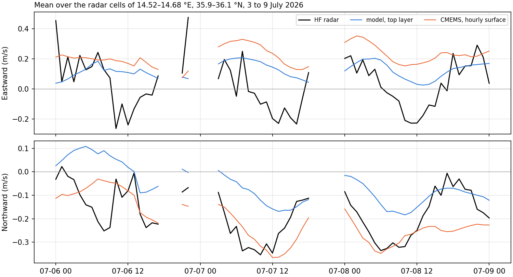
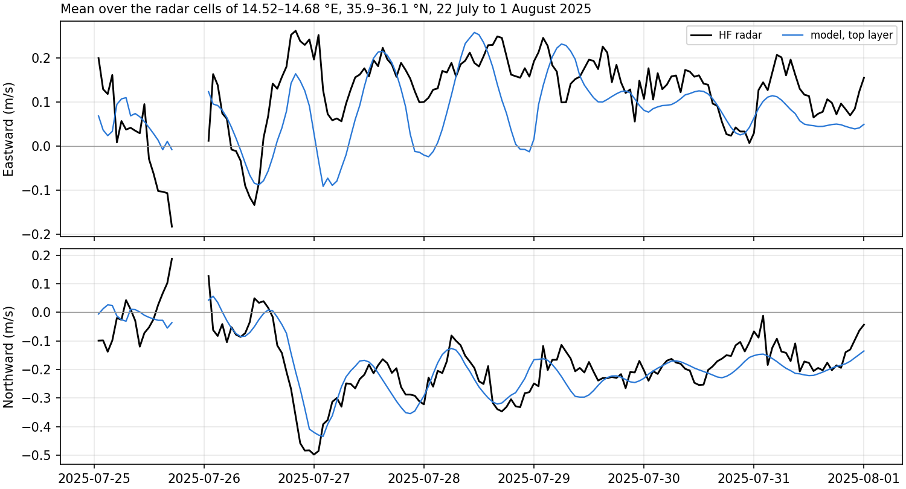

# Surface currents of the CALYPSO HF radar against the hindcast runs

Scripts `scripts/download_hfr_calypso.py` and `scripts/hfr_skill.py`. Metrics in `data/processed/hfr_skill.csv`, figures `figures/hfr_skill_*.png`.

## 1. Network and access

CALYPSO is the network of high-frequency (HF) radars installed across the Malta Channel under the CALYPSO, CALYPSO FollowOn and CALYPSO South projects of the Italia-Malta programme. It is managed by the University of Malta (A. Gauci), the University of Palermo (G. Ciraolo and F. Capodici), CNR-IAS and ARPA Sicilia. All stations are CODAR SeaSonde radars, which find the direction of each return by direction finding. The accuracy of the surface current field was assessed against drifters, near-surface ADCP measurements and baselines between sites by Capodici et al. (2019), Remote Sensing of Environment 225, 65–76.

The European HFR Node distributes the data through its ERDDAP server, `erddap.hfrnode.eu`, to which the EMODnet Physics server redirects, under a Creative Commons Attribution 4.0 licence with a prescribed acknowledgement. Two products are used.

- **Totals** (`EUHFR_NRTcurrent_HFR-CALYPSO-Total_v3`). Hourly eastward and northward components from November 2022, on a regular grid of 0.0334 by 0.0270 degrees (about 3 km) over 13.69 to 15.37 E and 35.74 to 36.88 N. The node combines the radials of two or more stations by least squares and supplies standard deviations, the geometric dilution of precision and quality flags.
- **Radials** (`EUHFR_NRTcurrent_HFR-CALYPSO-<site>_v3`). The velocity along the line of sight of each station, on a polar grid of 3.02 km in range and 5 degrees in bearing. Four stations stand on the Maltese Islands, listed below. The Sicilian stations (LICA, MRAG, POZZ) see domain B only at long range and are not used.
  - Ta' Barkat (BARK), 14.5561 E, 35.8825 N, some 2 km east of the mouth of the Grand Harbour.
  - Ta' Ċenċ (CENC), on Gozo.
  - Għar Lapsi (LAPS), on the south-west coast of Malta.
  - Ta' Sopu (SOPU), on Gozo.

The radar frequency is not stated in the files, so the depth over which the measured current is averaged, which follows from the radar wavelength, is not quantified here. The comparison is made with the top layer of the model, 1 per cent of the column.

## 2. Availability over the windows of the runs

The three windows are those of the runs in the working configuration (20 stretched sigma layers, daily CMEMS current at the boundary, thin dams at the breakwaters), extended by one day on either side.

| Window | Run | Hours | BARK | CENC | LAPS | SOPU | Totals, median cells per hour |
|---|---|---|---|---|---|---|---|
| 16 to 23 May 2026 | `v03_3d20s_0517_0522_uv_thd_2026` | 192 | 2 | 190 | 192 | record ends 12 Feb 2026 | 748 |
| 2 to 10 July 2026 | `v03_3d20s_0703_0709_uv_thd_2026` | 216 | 216 | 2 | 214 | record ends 12 Feb 2026 | 1042 |
| 21 July to 2 August 2025 | `v03_3d20s_0722_0801_uv_thd` | 312 | 312 | 311 | 197 | 308 | 1164 |

The record of Ta' Sopu ends on 12 February 2026, and in 2026 either Ta' Ċenċ or Ta' Barkat is absent from each window. The totals of 2026 therefore lack the overlap of two Maltese stations that the coverage along the north-east coast depends on. In May no total falls within some 15 km of that coast, and in July none falls south of 36.03 N there (Figures 6 and 1). In 2025 the four stations operate together and the totals reach within one or two cells of the coast from Gozo to the south-east of Malta (Figure 4).

## 3. Quality control and the convention of the radials

**Flags.** Totals enter with the overall quality flag of the node equal to 1 (good), which keeps 94 per cent of the values in July 2026. For the radials, the overall flag is 4 (bad data) at every cell of every station in every window. The flag is set by the average radial bearing test (`AVRB_QC`) alone, while the over-water, velocity threshold, median filter, radial count and position tests pass at nearly every cell. The average radial bearing test checks the station as a whole against an expected bearing, so a uniform failure indicates a threshold in the processing of the node rather than defective velocities. Radials therefore enter when every other test is passed, or when the temporal derivative test (`VART_QC`) was not performed.

**Direction of the radial vector.** The files label the radial velocity `RDVA` as positive away from the instrument and the direction `DRVA` as that of the radial vector away from the instrument. In every file, `DRVA` lies 180 degrees from the bearing of the bin. The eastward and northward components stored in the same files equal `RDVA` times the sine and cosine of the bearing, to within 0.002 to 0.007 m/s, and differ by up to 2.2 m/s when composed with `DRVA`. Projecting the model and CMEMS on `DRVA` gives correlations of −0.36 to −0.66 against the radar, and the sign reverses when the projection is on the bearing. `RDVA` is therefore positive away from the antenna along the bearing, and `DRVA` points towards the antenna. The modelled radial velocity is the projection of the current on the geodesic azimuth at the bin, pointing away from the antenna.

## 4. Comparison

Only radar cells inside the mesh of domain B are kept, 595 total cells and 856 bins of Ta' Barkat. The model starts from rest, so the first 72 hours of each run are excluded. That leaves 49 hours in May, 73 in July 2026 and 169 in 2025.

The top layer of the model is interpolated linearly between face centres at each radar cell, a point value set against a radar estimate over some 3 km. CMEMS is the hourly surface current of the Mediterranean analysis-forecast product, which forces the boundary of the model; it is interpolated to the cell after the coastal gaps of the product are filled by the nearest sea value, as in `drifter_skill_2026.py`. CMEMS is not available hourly for 2025 and is omitted from that window.

The statistics for the totals are listed below.
- The mean vectors.
- The root mean square of the vector difference.
- The complex correlation of Kundu (1976) on the demeaned series. Its modulus measures the agreement of the fluctuations, and its phase the mean veering of the model from the radar, positive anticlockwise.
- The ratio of the standard deviations.

For the radials they are the bias, the root mean square difference and the Pearson correlation.

The box north-east of Malta, 14.52 to 14.68 E and 35.90 to 36.10 N, encloses the stretch where the July drifters departed from the model ([drifters_2026_dataset.md](drifters_2026_dataset.md), Section 5). For the totals, the series averaged over the box is formed at hours with at least five good cells. For the radials, the bins in the box are averaged at hours with at least twenty.

## 5. Results

**Totals over domain B, all cells and hours pooled.**

| Window | Source | Values | Complex correlation | Phase (°) | RMS difference (m/s) | Mean speed, radar / source (m/s) |
|---|---|---|---|---|---|---|
| May 2026 | model | 8456 | 0.21 | 25 | 0.28 | 0.24 / 0.14 |
| May 2026 | CMEMS | 9278 | 0.53 | 0 | 0.23 | 0.25 / 0.17 |
| July 2026 | model | 14 915 | 0.20 | 72 | 0.32 | 0.29 / 0.15 |
| July 2026 | CMEMS | 16 432 | 0.23 | 34 | 0.31 | 0.29 / 0.23 |
| July–August 2025 | model | 56 602 | 0.23 | −21 | 0.33 | 0.34 / 0.23 |

**Totals averaged over the north-east box.**

| Window | Source | Hours | Complex correlation | Phase (°) | Std ratio | RMS difference (m/s) | Mean (u, v), radar (m/s) | Mean (u, v), source (m/s) |
|---|---|---|---|---|---|---|---|---|
| July 2026 | model | 61 | 0.58 | 52 | 0.50 | 0.24 | (0.03, −0.18) | (0.12, −0.06) |
| July 2026 | CMEMS | 61 | 0.49 | 39 | 0.57 | 0.27 | (0.03, −0.18) | (0.22, −0.21) |
| July–August 2025 | model | 162 | 0.75 | −14 | 0.91 | 0.11 | (0.12, −0.17) | (0.08, −0.18) |

In May only 15 hours hold five good cells in the box, too few for the statistic.

**Radials of Ta' Barkat in the north-east box.**

| Window | Source | Values | Correlation | RMS difference (m/s) | Mean, radar / source (m/s) |
|---|---|---|---|---|---|
| July 2026 | model | 3809 | 0.45 | 0.145 | −0.110 / −0.026 |
| July 2026 | CMEMS | 3809 | 0.62 | 0.102 | −0.110 / −0.093 |
| July–August 2025 | model | 7667 | 0.59 | 0.125 | −0.145 / −0.144 |

Over all the bins of the station in domain B, the correlation is 0.36 for the model and 0.60 for CMEMS in July 2026, and 0.66 for the model in 2025.

*Figure 1. Surface current from 6 to 9 July 2026, after 72 h of spin-up, at the total cells of the CALYPSO network inside domain B with a good value in at least half the hours. (a to c) Mean current of the radar, of the top layer of the model and of the hourly CMEMS surface current. (d) Fraction of hours with a good total. (e, f) Modulus of the complex correlation with the radar, cell by cell. The red box is the stretch north-east of Malta crossed by the drifters.*

*Figure 2. Eastward and northward current averaged over the total cells in the north-east box, 6 to 9 July 2026. Hours with fewer than five good cells are left blank.*

*Figure 3. (a) Bins of the station at Ta' Barkat inside domain B, shaded by the fraction of hours with a good radial, 6 to 9 July 2026. (b) Radial velocity averaged over the bins in the north-east box, positive away from the antenna, so that a southward or south-westward current off the north-east coast is negative.*

*Figure 4. As Figure 1, for 25 July to 1 August 2025 without CMEMS.*

*Figure 5. As Figure 2, for 25 July to 1 August 2025.*

*Figure 6. As Figure 1, for 20 to 22 May 2026, when Ta' Barkat holds two hours and the north-east coast lies outside the coverage of the totals.*

## 6. Interpretation

Pooled over all cells, the complex correlation is low for CMEMS as well as for the model, 0.23 to 0.53, so the pooled value reflects the variability of individual total cells at the margin of the coverage as much as either field. The comparison is more discriminating over the box north-east of Malta, where the radials of Ta' Barkat and, in 2025, the totals are densest.

In the 2025 window, after 72 hours of spin-up, the top layer of the model reproduces the series averaged over the box, with a complex correlation of 0.75, a veering of 14 degrees, 91 per cent of the variance and a mean northward current of −0.18 m/s against −0.17 m/s observed (Figure 5). The southward pulse of −0.45 to −0.50 m/s on 26 and 27 July is reproduced, as are the oscillations of about one day in the eastward component that follow it. The radials of Ta' Barkat in the box agree in the mean to within 0.001 m/s.

In July 2026, the radar records a southward current of −0.30 to −0.35 m/s in the box on 7 and 8 July, during the wind maxima. CMEMS reproduces it and the model carries about half (Figures 2 and 3). The radial velocity averaged over the box reaches −0.27 m/s in the radar and −0.25 m/s in CMEMS, and −0.13 to −0.14 m/s in the model, some hours later. This reproduces, over the whole box and at hourly resolution, the departure found along the drifter tracks, and it locates the departure in the same stretch and at the same hours. CMEMS, however, carries an eastward mean of 0.22 m/s that the radar does not record, so it is not the closer field in both components.

The two runs share the configuration and differ in season and in the length of the scored window. The 2025 run is scored from its fourth to its tenth day and the July 2026 run from its fourth to its sixth day. The agreement in 2025 and the departure in 2026 are consistent with a spin-up longer than three days for the surface flow off the north-east coast, one of the three causes left open by the drifter comparison, and do not establish it, since the forcing of the two summers also differs. The summer renewal run started in mid-June 2026 would score July 2026 after some three weeks of spin-up against the same radials and totals, and separates the two explanations.

## 7. Open items

1. The uniform failure of the average radial bearing test and the reversed direction `DRVA` in the radials of the node, to be raised with the group, which manages the network, before the radials enter a publication.
2. The radar frequency of the Maltese stations, which sets the depth sampled by the radar against the top layer of the model, and the share of the Stokes drift in the measured current.
3. The coverage of 2026, with Ta' Sopu out since February and Ta' Ċenċ and Ta' Barkat absent in turn, which limits the totals along the north-east coast. The radials of Ta' Barkat cover that stretch on their own.
4. The comparison over the full summer of 2026 once the renewal run is available, and an hourly CMEMS current for 2025 should that window be scored against CMEMS.
