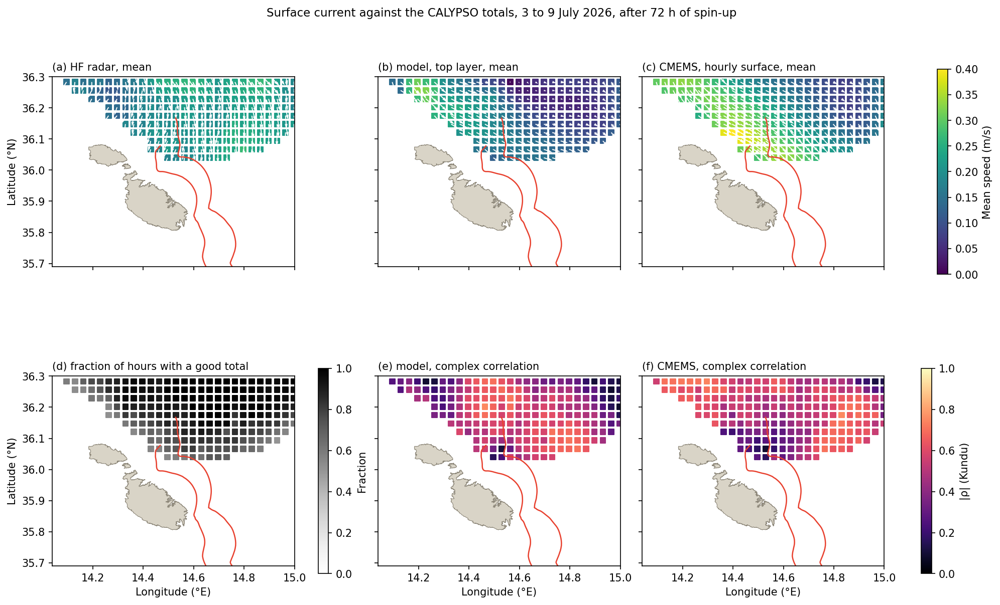
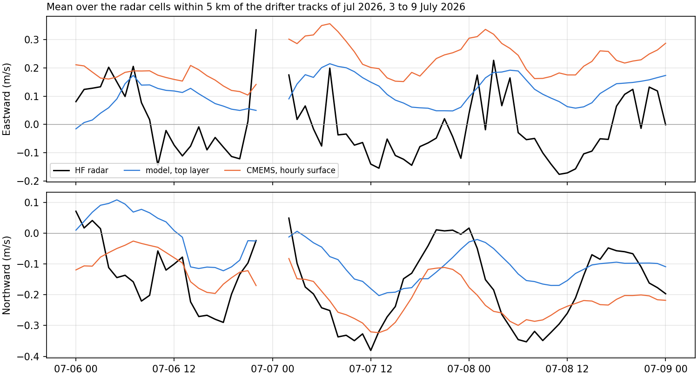
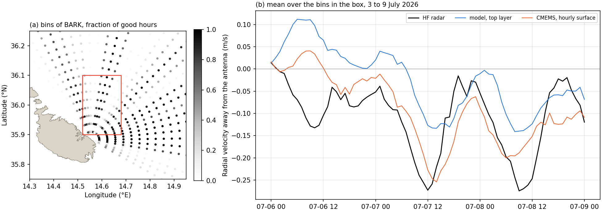
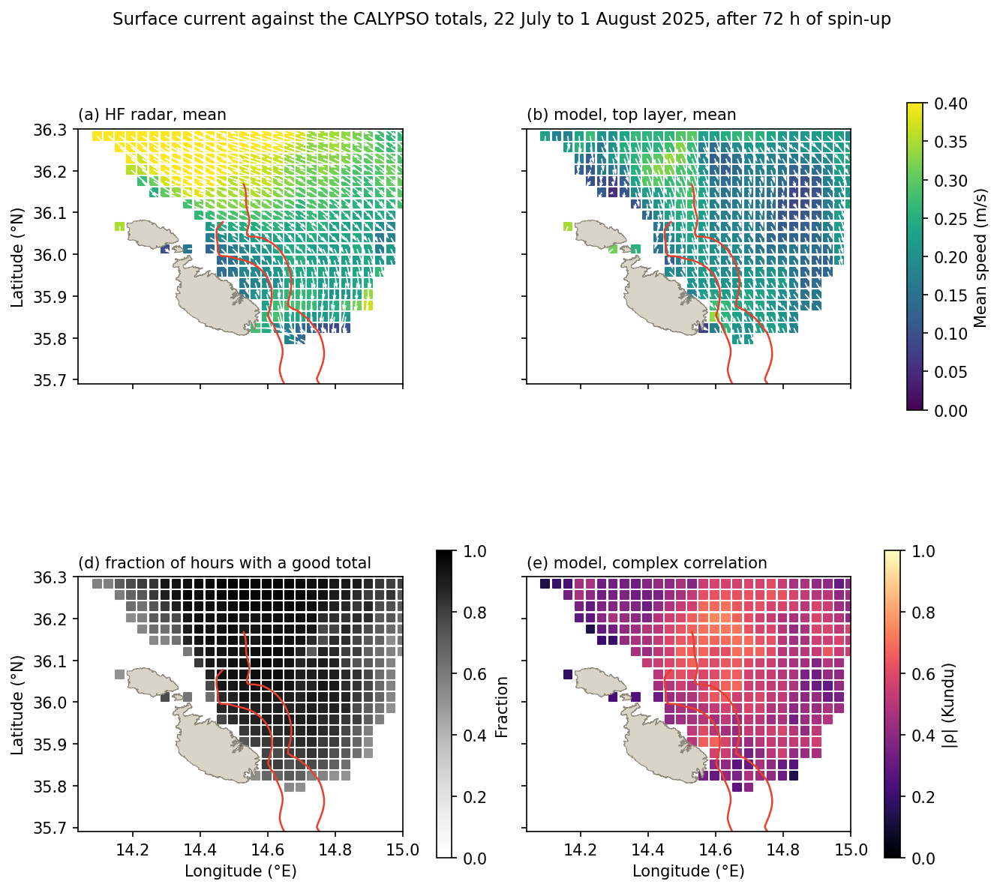
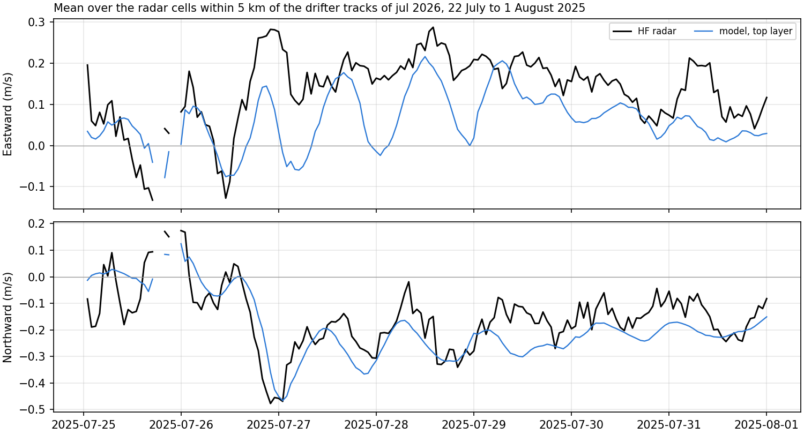
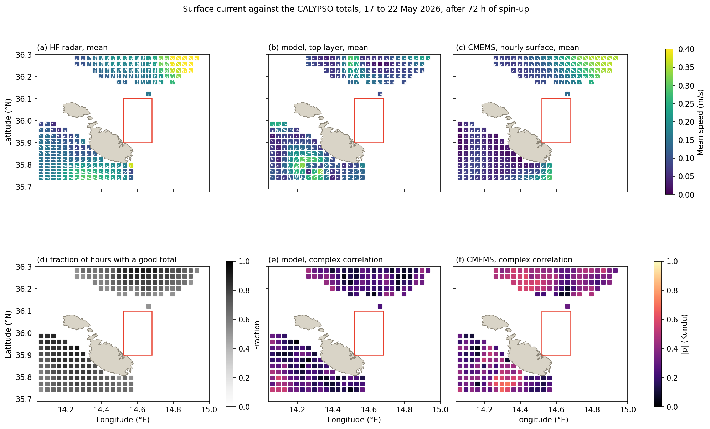
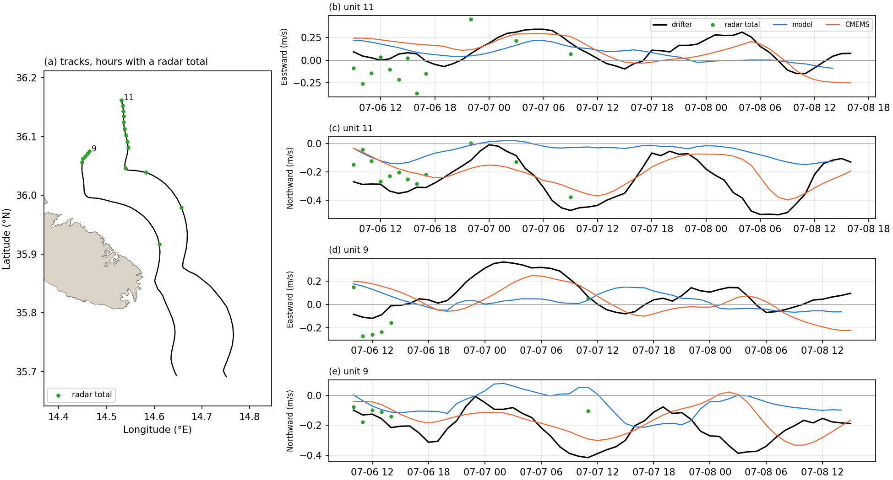

# Surface currents of the CALYPSO HF radar against the hindcast runs and the 2026 drifters

Scripts `scripts/download_hfr_calypso.py`, `scripts/hfr_skill.py` and `scripts/hfr_drifter_collocation.py`. Metrics in `data/processed/hfr_skill.csv`, `data/processed/hfr_drifter_metrics.csv` and, hour by hour along the tracks, `data/processed/hfr_drifter_collocation.csv`. Figures `figures/hfr_skill_*.png` and `figures/hfr_drifter_*.png`.

## 1. Network and access

CALYPSO is the network of high-frequency (HF) radars installed across the Malta Channel under the CALYPSO, CALYPSO FollowOn and CALYPSO South projects of the Italia-Malta programme. It is managed by the University of Malta (A. Gauci), the University of Palermo (G. Ciraolo and F. Capodici), CNR-IAS and ARPA Sicilia.

The network was validated by Capodici et al. (2019), *Validation of HF radar sea surface currents in the Malta-Sicily Channel*, Remote Sensing of Environment 225, 65–76 (copy in `reference/`), on the configuration of 2012 and 2013, which comprised three CODAR SeaSonde direction-finding radars, at Ta' Barkat (BARK) and Ta' Sopu (SOPU) on the Maltese Islands and at Pozzallo (POZZ) in Sicily. The settings stated there are listed below.

- Central frequency 13.5 MHz, bandwidth 90 kHz, angular resolution 5 degrees, hourly radials.
- The current measured is representative of the first metre of the water column at that frequency.
- Totals are combined by least squares on a grid of 3 by 3 km, within a search radius of 6 km, from beams intersecting at 30 to 150 degrees.

The comparison is therefore made with the top layer of the model, 1 per cent of the column, some 1.3 m thick at the median depth of 132 m along the July tracks ([drifters_2026_dataset.md](drifters_2026_dataset.md)).

The European HFR Node distributes the data through its ERDDAP server, `erddap.hfrnode.eu`, to which the EMODnet Physics server redirects. The data are released under a Creative Commons Attribution 4.0 licence with a prescribed acknowledgement. Two products are used.

- **Totals** (`EUHFR_NRTcurrent_HFR-CALYPSO-Total_v3`). Hourly eastward and northward components from November 2022 on a regular grid of 0.0334 by 0.0270 degrees (about 3 km) over 13.69 to 15.37 E and 35.74 to 36.88 N, with standard deviations, the geometric dilution of precision and quality flags.
- **Radials** (`EUHFR_NRTcurrent_HFR-CALYPSO-<site>_v3`). The velocity along the line of sight of each station, on a polar grid of 3.02 km in range and 5 degrees in bearing. Four stations stand on the Maltese Islands, listed below. The Sicilian stations (LICA, MRAG, POZZ) see domain B only at long range and are not used.
  - Ta' Barkat (BARK), 14.5561 E, 35.8825 N, some 2 km east of the mouth of the Grand Harbour.
  - Ta' Ċenċ (CENC), on Gozo.
  - Għar Lapsi (LAPS), on the south-west coast of Malta.
  - Ta' Sopu (SOPU), on Gozo.

## 2. Availability over the windows of the runs

The three windows are those of the runs in the working configuration (20 stretched sigma layers, daily CMEMS current at the boundary, thin dams at the breakwaters), extended by one day on either side.

| Window | Run | Hours | BARK | CENC | LAPS | SOPU | Totals, median cells per hour |
|---|---|---|---|---|---|---|---|
| 16 to 23 May 2026 | `v03_3d20s_0517_0522_uv_thd_2026` | 192 | 2 | 190 | 192 | record ends 12 Feb 2026 | 748 |
| 2 to 10 July 2026 | `v03_3d20s_0703_0709_uv_thd_2026` | 216 | 216 | 2 | 214 | record ends 12 Feb 2026 | 1042 |
| 21 July to 2 August 2025 | `v03_3d20s_0722_0801_uv_thd` | 312 | 312 | 311 | 197 | 308 | 1164 |

The record of Ta' Sopu ends on 12 February 2026, and in 2026 either Ta' Ċenċ or Ta' Barkat is absent from each window. The totals of 2026 therefore lack the overlap of two Maltese stations on which the coverage along the north and north-east coasts depends. Capodici et al. (2019) found the totals most reliable where the contributing stations are balanced and the drifter separations largest where the geometry is suboptimal. In May no total falls within some 15 km of the north-east coast, and in July none falls south of 36.03 N there (Figures 1 and 6). In 2025 the four stations operate together and the totals reach within one or two cells of the coast from Gozo to the south-east of Malta (Figure 4).

## 3. Quality control and the convention of the radials

**Flags.** Totals enter with the overall quality flag of the node equal to 1 (good), which keeps 94 per cent of the values in July 2026. For the radials, the overall flag is 4 (bad data) at every cell of every station in every window. The flag is set by the average radial bearing test (`AVRB_QC`) alone, while the over-water, velocity threshold, median filter, radial count and position tests pass at nearly every cell. The average radial bearing test checks the station as a whole against an expected bearing, so a uniform failure indicates a threshold in the processing of the node rather than defective velocities. Radials therefore enter when every other test is passed, or when the temporal derivative test (`VART_QC`) was not performed.

**Direction of the radial vector.** The files label the radial velocity `RDVA` as positive away from the instrument and the direction `DRVA` as that of the radial vector away from the instrument. In every file `DRVA` lies 180 degrees from the bearing of the bin. The eastward and northward components stored in the same files equal `RDVA` times the sine and cosine of the bearing to within 0.002 to 0.007 m/s, and differ by up to 2.2 m/s when composed with `DRVA`. Projecting the model and CMEMS on `DRVA` gives correlations of −0.36 to −0.66 against the radar, and the sign reverses when the projection is on the bearing. `RDVA` is therefore positive away from the antenna along the bearing, and `DRVA` points towards the antenna. Modelled and drifter radial velocities are the projection of the current on the geodesic azimuth at the point, pointing away from the antenna.

**Antenna pattern.** The radials carry the calibration type APM, the measured antenna pattern. Capodici et al. (2019) found that, for Ta' Barkat alone, the radials of the ideal pattern matched the drifters better than those of the measured pattern, and found no bearing offset for that station against 5 to 10 degrees for Ta' Sopu.

## 4. Comparison

### 4.1 Fields

Only radar cells inside the mesh of domain B are kept, 595 total cells and 856 bins of Ta' Barkat. The model starts from rest, so the first 72 hours of each run are excluded from the comparison of fields. That leaves 49 hours in May, 73 in July 2026 and 169 in 2025.

The top layer of the model is interpolated linearly between face centres at each radar cell, a point value set against a radar estimate over some 3 km. CMEMS is the hourly surface current of the Mediterranean analysis-forecast product, which forces the boundary of the model. It is interpolated to the cell after the coastal gaps of the product are filled by the nearest sea value, as in `drifter_skill_2026.py`. CMEMS is not available hourly for 2025 and is omitted from that window.

The statistics for the totals are listed below.
- The mean vectors.
- The root mean square of the vector difference.
- The complex correlation of Kundu (1976) on the demeaned series. Its modulus measures the agreement of the fluctuations, and its phase the mean veering of the model from the radar, positive anticlockwise.
- The ratio of the standard deviations.

For the radials they are the bias, the root mean square difference and the Pearson correlation.

The comparison is made over all of domain B and over the corridor of the drifter tracks, the radar cells within 5 km of any drifting fix of the month inside domain B (Figure 7). For the totals, the series averaged over the corridor is formed at hours with at least five good cells. For the radials, it is formed at hours with at least ten good bins. The window of 2025 has no drifters and takes the corridor of July 2026, so that the two summers are scored over the same water. Within the corridor the totals of July 2026 cover only the stretch north of 36.03 N, at the start of both tracks, while the radials of Ta' Barkat cover the stretch along the coast as well.

### 4.2 Drifters

The comparison with the drifters follows the procedure of Capodici et al. (2019) where the data allow it. In that study the drifters were SVP units with a holey-sock drogue centred at 15 m, positions every hour with some 10 m of accuracy, interpolated to regular hourly intervals by kriging and differenced to velocity, with a stated accuracy of 1 to 3 cm/s and a wind slip of about 0.1 per cent of the wind speed. Drifter and radar were matched at the closest hourly map within a search radius of 1 km in the first deployment and 3 km in the later ones. The statistics were the correlation, the rms difference and the slope and intercept of the regression of radar on drifter with their 95 per cent limits, for each component and for the radials of each station.

The units of 2026 report positions at about 30 minutes, and their draft and exposed height are not confirmed ([drifters_2026_dataset.md](drifters_2026_dataset.md)). Their velocity is formed at every full hour of the drifting part of each track inside domain B, as the displacement between the positions interpolated linearly half an hour before and half an hour after, so that it spans the hour over which the radar averages. At each point the drifter is matched with four estimates.

- The radar total in the grid cell containing it, within some 1.5 km of the cell centre.
- The radial of each Maltese station in the bin containing it, within half a range cell and half a bearing cell.
- The top layer of the model.
- The hourly CMEMS surface current.

The drifter is the reference, so that the regression is that of each source on the drifter. Spin-up is not excluded here, since the releases fall on the fourth day of each run.

Capodici et al. (2019) also restricted part of their statistics to pairs whose difference lies within ±6 cm/s, to discount the vertical shear between the drogue at 15 m and the radar near the surface. That restriction selects agreement and is not applied to the evaluation of the model.

## 5. Results

### 5.1 Fields over domain B and over the corridor of the tracks

**Totals over domain B, all cells and hours pooled.**

| Window | Source | Values | Complex correlation | Phase (°) | RMS difference (m/s) | Mean speed, radar / source (m/s) |
|---|---|---|---|---|---|---|
| May 2026 | model | 8456 | 0.21 | 25 | 0.28 | 0.24 / 0.14 |
| May 2026 | CMEMS | 9278 | 0.53 | 0 | 0.23 | 0.25 / 0.17 |
| July 2026 | model | 14 915 | 0.20 | 72 | 0.32 | 0.29 / 0.15 |
| July 2026 | CMEMS | 16 432 | 0.23 | 34 | 0.31 | 0.29 / 0.23 |
| July–August 2025 | model | 56 602 | 0.23 | −21 | 0.33 | 0.34 / 0.23 |

**Totals averaged over the corridor of the July tracks.**

| Window | Source | Hours | Complex correlation | Phase (°) | Std ratio | RMS difference (m/s) | Mean (u, v), radar (m/s) | Mean (u, v), source (m/s) |
|---|---|---|---|---|---|---|---|---|
| July 2026 | model | 70 | 0.66 | 57 | 0.59 | 0.22 | (0.00, −0.16) | (0.11, −0.07) |
| July 2026 | CMEMS | 70 | 0.50 | 19 | 0.61 | 0.27 | (0.00, −0.16) | (0.22, −0.18) |
| July–August 2025 | model | 164 | 0.74 | −21 | 0.96 | 0.14 | (0.14, −0.16) | (0.06, −0.19) |

The corridor of the May tracks, along the north coast west of the harbours, holds seven good totals in the 49 hours, too few for any statistic.

**Radials of Ta' Barkat in the corridor of the July tracks.**

| Window | Source | Values | Correlation | RMS difference (m/s) | Mean, radar / source (m/s) |
|---|---|---|---|---|---|
| July 2026 | model | 7802 | 0.46 | 0.151 | −0.025 / −0.001 |
| July 2026 | CMEMS | 7802 | 0.68 | 0.128 | −0.025 / −0.055 |
| July–August 2025 | model | 17 955 | 0.77 | 0.141 | −0.043 / −0.017 |

Over all the bins of the station in domain B, the correlation is 0.36 for the model and 0.60 for CMEMS in July 2026, and 0.66 for the model in 2025.

*Figure 1. Surface current from 6 to 9 July 2026, after 72 h of spin-up, at the total cells of the CALYPSO network inside domain B with a good value in at least half the hours. (a to c) Mean current of the radar, of the top layer of the model and of the hourly CMEMS surface current. (d) Fraction of hours with a good total. (e, f) Modulus of the complex correlation with the radar, cell by cell. The red lines are the drifter tracks of 6 to 8 July.*

*Figure 2. Eastward and northward current averaged over the total cells within 5 km of the July tracks, 6 to 9 July 2026. Hours with fewer than five good cells are left blank.*

*Figure 3. (a) Bins of the station at Ta' Barkat inside domain B, shaded by the fraction of hours with a good radial, 6 to 9 July 2026, with the drifter tracks. (b) Radial velocity averaged over the bins within 5 km of the tracks, positive away from the antenna, so that a southward current north-east of the station is negative.*

*Figure 4. As Figure 1, for 25 July to 1 August 2025 without CMEMS, with the tracks of July 2026.*

*Figure 5. As Figure 2, for 25 July to 1 August 2025, over the corridor of the July 2026 tracks.*

*Figure 6. As Figure 1, for 20 to 22 May 2026, when Ta' Barkat holds two hours and the tracks along the north coast lie outside the coverage of the totals.*

### 5.2 Drifters

In May no radar value, total or radial, falls on the tracks. In July, 18 of the 110 drifter hours fall in a cell with a good total, 14 of them within the first 12 hours north of 36.04 N, and 23 fall in a good bin of Ta' Barkat (Figure 7). Ta' Ċenċ holds no data on those days, and Għar Lapsi holds one bin on the tracks.

**Velocity components against the drifters, July 2026.**

| Component | Source | N | R | rmsd (m/s) | Slope a [95 %] | Intercept b (m/s) |
|---|---|---|---|---|---|---|
| U | radar total | 18 | 0.45 | 0.21 | 0.88 [−0.04, 1.81] | −0.10 |
| V | radar total | 18 | 0.63 | 0.13 | 0.52 [0.18, 0.86] | −0.03 |
| U | model | 107 | 0.08 | 0.16 | 0.05 [−0.07, 0.16] | 0.05 |
| V | model | 107 | 0.11 | 0.23 | 0.05 [−0.04, 0.15] | −0.04 |
| U | CMEMS | 110 | 0.47 | 0.15 | 0.50 [0.32, 0.68] | 0.02 |
| V | CMEMS | 110 | 0.45 | 0.13 | 0.34 [0.21, 0.47] | −0.11 |

**Radial velocity of Ta' Barkat against the drifter velocity projected on the same direction, July 2026.**

| Source | N | R | rmsd (m/s) | Slope a [95 %] | Intercept b (m/s) |
|---|---|---|---|---|---|
| radar | 23 | 0.93 | 0.059 | 0.87 [0.71, 1.02] | 0.010 |
| model | 23 | −0.01 | 0.213 | 0.00 [−0.18, 0.18] | 0.074 |
| CMEMS | 23 | 0.88 | 0.091 | 0.44 [0.33, 0.55] | −0.031 |

In May, over 50 drifter hours along the north coast, the components correlate at 0.27 and −0.08 with the model and at 0.22 and 0.26 with CMEMS, with rms differences of 0.09 to 0.13 m/s for both.

*Figure 7. (a) Tracks of units 9 and 11 inside domain B, 6 to 8 July 2026, with the hours at which a good radar total falls on the track. (b to e) Hourly velocity of each unit, from the positions half an hour either side, against the radar total in the same cell, the top layer of the model and the hourly CMEMS surface current at the same point.*

## 6. Interpretation

Capodici et al. (2019) report correlations of 0.62 to 0.70 and rms differences of 10 to 14 cm/s between the radials of Ta' Barkat and drogued drifters in the deployment with the longest record, and 0.75 and 0.86 with rms differences of 12.6 and 9.8 cm/s for the components of the totals over all four deployments. Against the units of 2026, the radials of the same station give 0.93 and 5.9 cm/s over 23 hours, with a slope of 0.87 whose limits include one. The sample is short and confined to the stretch north-east of the station on 6 and 7 July, and it supports no general statement on the accuracy of the radar. It does indicate that the 2026 units and the radar sample a current that agrees at the hourly scale, which the drogue at 15 m of the earlier study, against the first metre sampled by the radar, would not lead to expect. The totals agree less well with the drifters, 0.45 and 0.63 over 18 hours at the start of the tracks. These are the hours at the southern margin of the coverage of 2026, where only Ta' Barkat contributes from the Maltese side.

Pooled over all cells, the complex correlation of the totals is low for CMEMS as well as for the model, 0.23 to 0.53, so the pooled value reflects the variability of individual total cells at the margin of the coverage as much as either field. The corridor of the tracks and the drifters themselves discriminate between the fields.

In the 2025 window, after 72 hours of spin-up, the top layer of the model reproduces the series averaged over the corridor of the July tracks. The complex correlation is 0.74, the veering 21 degrees clockwise, the ratio of standard deviations 0.96 and the mean northward current −0.19 m/s against −0.16 m/s observed (Figure 5). The southward pulse of −0.45 to −0.50 m/s on 26 and 27 July is reproduced, as are the oscillations of about one day that follow it. The radials of Ta' Barkat in the corridor correlate at 0.77.

In July 2026, the radar records a southward current of −0.35 to −0.38 m/s over the corridor in the mornings of 7 and 8 July, during the wind maxima, and the drifters −0.39 to −0.50 m/s. CMEMS carries −0.30 to −0.32 m/s at its minima and the model −0.17 to −0.20 m/s (Figures 2 and 7). Along the tracks the model reproduces neither component, correlations of 0.08 and 0.11, where CMEMS reaches 0.47 and 0.45, and the projection on the radials of Ta' Barkat isolates the same contrast, 0.88 for CMEMS against −0.01 for the model. CMEMS underestimates the variance, with slopes of 0.34 to 0.50, and its mean eastward current of 0.22 m/s over the corridor is not recorded by the radar.

The two runs share the configuration and differ in season and in the length of the scored window. The 2025 run is scored from its fourth to its tenth day and the July 2026 run from its fourth to its sixth day. The agreement in 2025 and the departure in 2026 over the same water are consistent with a spin-up longer than three days for the surface flow off the north-east coast, one of the three causes left open by the drifter comparison, and do not establish it, since the forcing of the two summers also differs. The summer renewal run started in mid-June 2026 would score July 2026 after some three weeks of spin-up against the same drifters, radials and totals, and separates the two explanations.

## 7. Open items

1. The uniform failure of the average radial bearing test and the reversed direction `DRVA` in the radials of the node, to be raised with the group before the radials enter a publication.
2. The present configuration of the Maltese stations against that of 2013, namely the frequency, the range cell of 3.02 km in the node product against 1.66 km in 2013, and the antenna pattern applied to Ta' Barkat, for which the ideal pattern matched the drifters better in 2013.
3. The draft and exposed height of the 2026 units, on which the agreement of the drifters with the radar near the surface bears.
4. The coverage of 2026, with Ta' Sopu out since February and Ta' Ċenċ and Ta' Barkat absent in turn, which limits the totals along the north-east coast. The radials of Ta' Barkat cover that stretch on their own.
5. The radar totals as a third field in `drifter_skill_2026.py`, scored by the separation of virtual drifters as in the 12-hour reseeding of Capodici et al. (2019), where the separation averaged 4.5 km at 6 hours, to bound the Lagrangian skill attainable from an observed surface field.
6. The comparison over the full summer of 2026 once the renewal run is available, and an hourly CMEMS current for 2025 should that window be scored against CMEMS.
