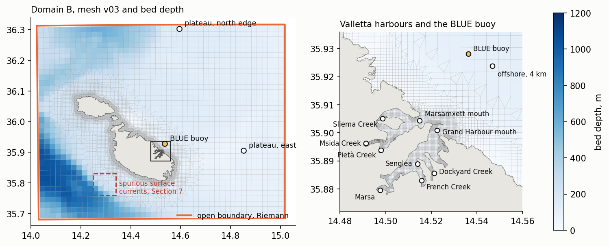
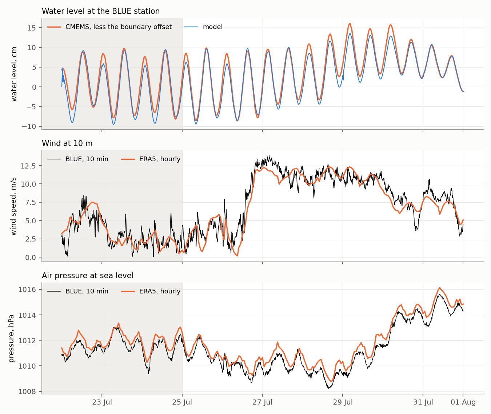
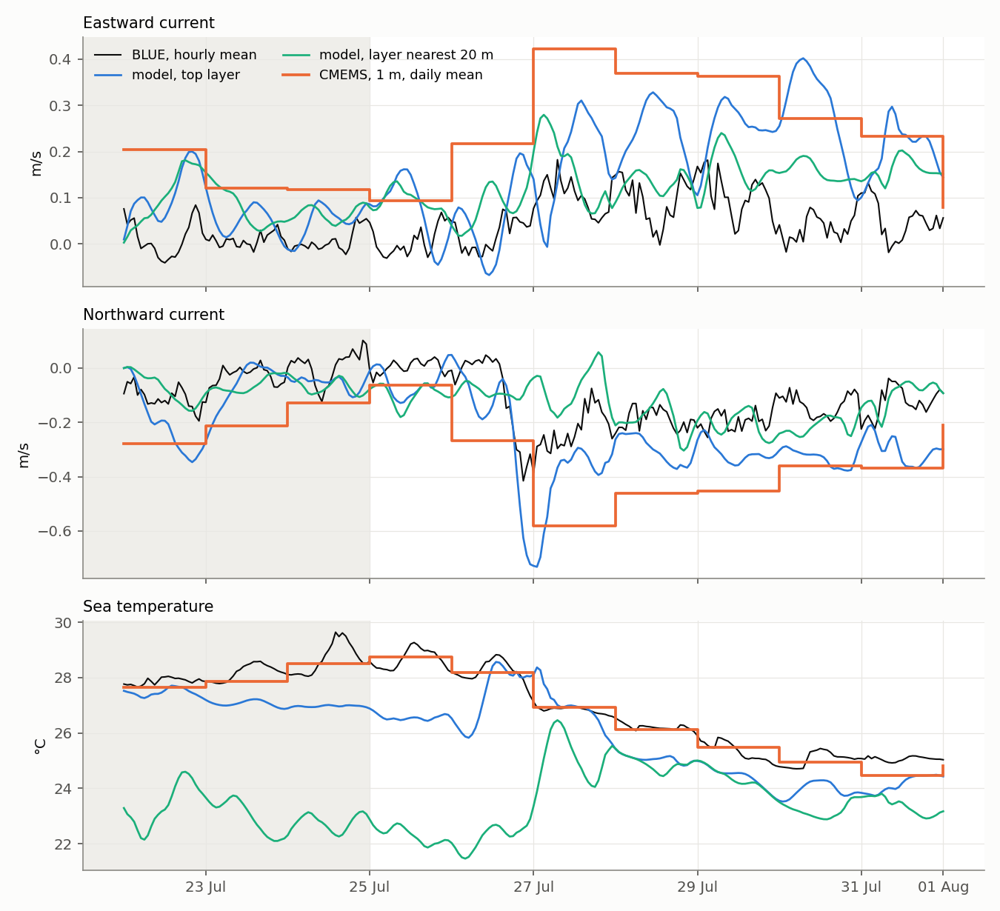
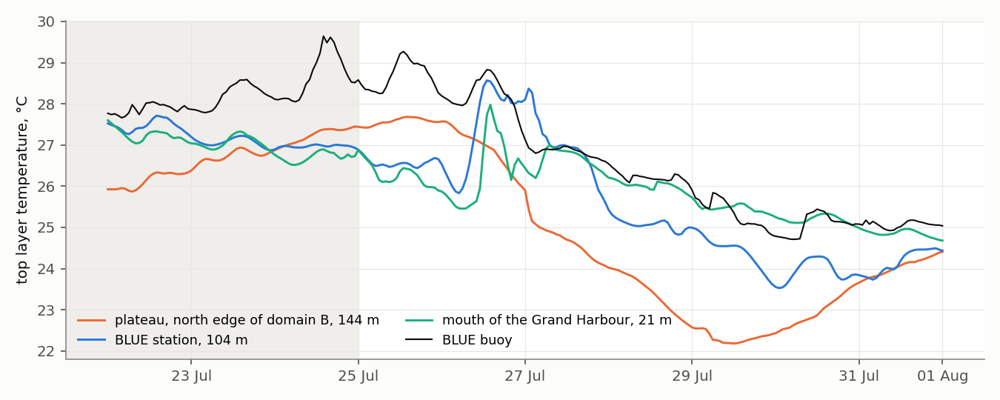

# First hindcast on mesh v03, 25 July to 1 August 2025

*Forcing downloaded by `scripts/download_cmems_hindcast.py` and `scripts/download_era5_hindcast.py`, cases built by `scripts/build_hindcast_v02.py`, run on simit-server by `scripts/run_fm_simit.sh`, compared by `scripts/analyse_hindcast_v02.py` and drawn by `scripts/figure_hindcast_first_week.py`. Cases under `model/hindcast/`, regenerated by the scripts and not versioned.*

The run is the first of the configuration forced by observed and analysed fields rather than by an idealised disturbance. It serves to test the chain from CMEMS and ERA5 to the open boundary and the surface of domain B, and to set the configuration against the only observation of the harbour approach available for 2025, the BLUE buoy ([blue_buoy_dataset.md](blue_buoy_dataset.md)). No public tide gauge recorded the window, since Senglea is offline from December 2024.

## Summary

**Work carried out.** The chain from CMEMS and ERA5 to domain B on mesh v03 is in place, with the Riemann boundary forced by half the CMEMS sea surface height (Section 2). Over the validation week the modelled level stays within 1 to 2 cm of CMEMS, and ERA5 reproduces the wind and pressure of the buoy at correlations of 0.93 and 0.99 (Section 3). Four three-dimensional cases were run, with sigma layers of equal or stretched thickness and with or without the CMEMS current at the boundary (Sections 4 and 5). The working configuration, 20 stretched sigma layers with the top one 1 per cent of the column and the daily CMEMS current at the boundary, removes the bias of the daily current at the buoy, from +0.12 and −0.14 m/s in the eastward and northward components of the reference case to +0.01 and −0.02 m/s. The surface heat fluxes agree with those of ERA5 within 11 to 32 W/m² (Section 6), and a week costs some 5.3 hours on 12 cores of simit-server (Section 8).

**Matters left open.** The top layer remains some 1.4 °C colder than the buoy after the wind of 27 July, independently of the boundary velocity and of the surface fluxes, and spurious top-layer currents above 1 m/s persist on 43 faces of the slope southwest of Malta (Section 7). Both lie outside the harbours and are not expected to bear on the questions of circulation and renewal, and their diagnosis is deferred (Section 9). The comparison of currents depends on the depth of measurement of the buoy, which is not stated in the file supplied.

**Further work and its requirements.** The configuration is intended for the runs of circulation and renewal of the harbours, the principal question of the study, with passive tracers or water age released by inlet, and for the geometry experiments that follow them. These runs require

1. the depth of the current and temperature sensors of the BLUE buoy, from the group, to settle the comparison of Sections 4 and 5;
2. windows longer than one week, at about 21 hours of simit-server for 40 days, and storage beyond the home partition of the server, since map output at 30 minutes occupies some 16 GB per 10 days;
3. an observation of the circulation inside the harbours, where the model is at present untested, through drifter releases or the HF radar surface currents near the harbour mouths;
4. the extents of the planned breakwaters and of the new pier at Msida, for the geometry experiments.

**Interactive maps.** The surface fields of the working configuration over 22 July to 1 August 2025, namely water level, sea surface temperature and currents drawn as moving particles, are published on the EDITO platform at <https://minio.dive.edito.eu/oidc-cmartinsjr/malta-hindcast/index.html>, with the series at the BLUE buoy and at the harbour stations. The eight scenarios of the long-wave sweep, one for each direction of arrival of the pressure disturbance ([longwave_sweep.md](longwave_sweep.md)), are published in the same form at <https://minio.dive.edito.eu/oidc-cmartinsjr/malta-longwave/index.html>.

## 1. Window and configuration

The validation window is 25 July to 1 August 2025, preceded by three days of spin-up from 22 July. Among the seven-day windows of late May to mid-September 2025 with all variables of the buoy present for at least 98 per cent of the time, it holds the strongest wind, a mean of 8.4 m/s with 95 per cent below 12.7 m/s, a mean current of 16.6 cm/s and a fall of 4.6 °C in sea temperature.

*Mesh v03 over domain B, shaded by bed depth, with the Riemann open boundary, the offshore stations and the area of the spurious surface currents of Section 7 (left), and the harbours with the BLUE buoy and the stations of the harbour inlets (right). The stations are placed at the nearest cell whose nodes all lie below −1 m. The BLUE station lies over 104 m, the plateau stations over 144 m (north edge) and the mouth of the Grand Harbour over 21 m.*

| Element | Setting |
|---|---|
| Mesh | v03, 26 767 faces ([harbour_bathymetry_cleaning.md](harbour_bathymetry_cleaning.md)) |
| Vertical | 20 sigma layers of equal thickness in the reference case, a working value, with the variants of Section 5 |
| Open boundary | Riemann, forced by half the CMEMS sea surface height of the analysis-forecast product at 15 minutes, less its mean over the run along the boundary (−0.29 m) |
| Boundary salinity and temperature | daily CMEMS reanalysis, `cmems_mod_med_phy-{sal,temp}_my_4.2km_P1D-m` |
| Boundary velocity | none in the reference case; in the variants of Section 5 the daily CMEMS current, written as `uxuyadvectionvelocitybnd` by `write_uv_boundary` in the builder, since the vector quantity of `dfm_tools.cmems_nc_to_bc` fails against hydrolib-core 1.0 |
| Initial salinity and temperature | daily CMEMS reanalysis of 22 July, through the nudging file with `iniWithNudge = 2` |
| Surface | hourly ERA5, wind at 10 m and mean sea level pressure, and dew point, air temperature, cloud cover and net solar and downward thermal radiation for the composite heat flux model (`temperature = 5`) |
| Turbulence | k-ε |
| Output | history at 1 minute, map at 30 minutes without the edge and turbulence fields |

The CMEMS products are those identified for the StagnoneDT hindcasts of July 2025, the sea surface height of the analysis-forecast system carrying the tide and the three-dimensional fields of that system beginning in October 2025.

## 2. Treatment of the open boundary

A two-day run in two dimensions, 22 to 24 July, tested the boundary against the CMEMS sea surface height inside the domain. With the whole CMEMS height prescribed as the Riemann value, the modelled level carried twice the CMEMS amplitude at every station, a ratio of standard deviations of 2.04, at correlations of 0.975 to 0.998. D-Flow FM takes the Riemann value as the incoming wave, and over a domain small against the length of the tide the normal velocity at the boundary is small and the level there approaches twice that value. With half the height prescribed, the ratio falls to 0.97 to 1.04 and the root mean square difference of the anomalies to 0.4 to 1.2 cm.

| Variant, 2D, 22 July 12:00 to 24 July | Ratio of standard deviations | RMS difference of anomalies |
|---|---|---|
| Whole CMEMS height | 1.93 to 2.08 | 5.6 to 6.1 cm |
| Whole height, `tidalForcing = 1` | 1.90 to 2.07 | 5.4 to 6.0 cm |
| Whole height, `pavBnd = 101325` | 1.93 to 2.08 | 5.6 to 6.1 cm |
| Half the CMEMS height | 0.97 to 1.04 | 0.4 to 1.2 cm |

The tide-generating potential changes the level by less than 2 mm over the domain, and the reference pressure at the boundary has no effect on a Riemann boundary, as found for the moving pressure disturbance ([moving_pressure_channel_test.md](moving_pressure_channel_test.md)). Both are kept off.

## 3. Level and forcing over the validation window

*Water level at the BLUE station against the CMEMS sea surface height less the boundary offset (top), and wind speed (centre) and pressure (bottom) of ERA5 against the buoy. Spin-up shaded.*

| Quantity, 25 July to 1 August | Correlation | Other |
|---|---|---|
| Level against CMEMS, six offshore stations | 0.977 to 0.985 | RMS difference of anomalies 1.0 to 1.2 cm, ratio of standard deviations 0.95 to 1.11, model lagging by 2 to 10 minutes |
| ERA5 wind speed against the buoy | 0.93 | bias −0.38 m/s, RMS 1.31 m/s |
| ERA5 pressure against the buoy | 0.99 | bias +0.52 hPa |

The level follows the CMEMS height over the whole week, including the rise of the mean level by some 8 cm from 28 to 30 July. ERA5 reproduces the onset and duration of the northwesterly wind of 27 to 29 July and falls short of the buoy by about 1 m/s at its peak.

## 4. Currents and temperature at the buoy

*Eastward (top) and northward (centre) current and sea temperature (bottom) at the BLUE buoy, against the top layer of the reference case, the layer nearest 20 m and the daily CMEMS field at 1 m. Spin-up shaded.*

| Reference case against the buoy, 25 July to 1 August | u bias, RMS, r | v bias, RMS, r | Temperature bias, RMS, r |
|---|---|---|---|
| Model, top layer, 10 min | +0.13, 0.18 m/s, 0.13 | −0.14, 0.17 m/s, 0.72 | −0.99, 1.25 °C, 0.85 |
| Model, layer nearest 20 m, 10 min | +0.08, 0.10 m/s, 0.30 | 0.00, 0.12 m/s, 0.24 | −2.86, 3.59 °C, −0.43 |
| Model, top layer, daily | +0.12, 0.14 m/s, 0.59 | −0.14, 0.15 m/s, 0.90 | −0.94, 1.11 °C, 0.91 |
| Model, layer nearest 20 m, daily | +0.08, 0.08 m/s, 0.67 | 0.00, 0.07 m/s, 0.36 | −2.73, 3.39 °C, −0.39 |
| CMEMS, 1 m, daily | +0.20, 0.22 m/s, 0.78 | −0.21, 0.23 m/s, 0.99 | −0.10, 0.24 °C, 0.99 |

**Current.** The direction of the reported current agrees with its components to within 5 degrees, so the convention of the buoy is consistent. The model, the CMEMS fields and the buoy agree on the mean direction of the flow, toward 146, 143 and 156 degrees respectively, during the northwesterly wind, and differ in its strength. The top layer of the model carries 0.35 m/s on average, the CMEMS field at 1 m 0.43 m/s and the buoy 0.16 m/s. At the four offshore stations the model is slower than CMEMS, 0.27 to 0.35 m/s against 0.38 to 0.50 m/s, so the difference from the buoy is shared by both models. The buoy agrees more closely with the model near 20 m, which suggests that the current is measured below the surface layer. The depth of measurement is not stated in the file supplied, and the comparison of currents is to be read once it is known.

**Temperature.** At the station the water column is 104 m deep and each sigma layer 5.2 m thick. Over the calm days of spin-up the net surface heat flux in the model is a gain of 136 to 217 W/m², while the top layer cools from 27.5 to 26.6 °C and the buoy and CMEMS warm by some 0.9 °C, the buoy showing a diurnal warm layer reaching 29.6 °C. The northwesterly wind mixes the column on 27 July, after which the model agrees with the buoy within about 0.2 °C for two days, and then cools by about 1 °C more than the buoy.

*Temperature of the top layer at the northern edge of domain B over 144 m, at the BLUE station over 104 m and at the mouth of the Grand Harbour over 21 m, with the buoy.*

During spin-up the top layer warms at the northern edge of the domain and cools at the stations near the coast of Malta, most at the mouth of the Grand Harbour, where the 21 m column is resolved by layers of about 1 m. The cooling under a heat gain points to vertical mixing that brings the colder water of the thermocline to the surface near the coast. Two elements of the configuration bear on it, the thickness of the surface layer over the deeper water, which cannot hold a near-surface warm layer of a metre or two, and the sigma layers over the steep slopes of the domain, which reaches 1 157 m. The CMEMS system, whose vertical levels are about 1 m thick near the surface, follows the buoy within 0.1 to 0.3 °C.

## 5. Vertical discretisation and boundary velocity

Three further cases share the reference configuration and change one or two elements of it. The stretched case keeps 20 sigma layers and sets the top one to 1 per cent of the column, the thickness growing geometrically toward the bed by a factor of about 1.15, so that the top layer is 1.0 m thick at the BLUE station against 5.2 m with layers of equal thickness. The two cases with boundary velocity add the daily CMEMS current at the open boundary to the uniform and to the stretched layers.

| Case, daily means at the buoy, 25 July to 1 August | u bias, RMS | v bias, RMS, r | Temperature bias, RMS | Level against CMEMS at BLUE, r, ratio of standard deviations |
|---|---|---|---|---|
| Uniform sigma | +0.12, 0.14 m/s | −0.14, 0.15 m/s, 0.90 | −0.94, 1.11 °C | 0.983, 0.95 |
| Uniform sigma, boundary velocity | +0.02, 0.09 m/s | −0.06, 0.09 m/s, 1.00 | −0.96, 1.08 °C | 0.982, 1.03 |
| Stretched sigma | −0.01, 0.08 m/s | +0.01, 0.06 m/s, 0.97 | −1.48, 1.51 °C | 0.905, 0.84 |
| Stretched sigma, boundary velocity | +0.01, 0.12 m/s | −0.02, 0.09 m/s, 0.99 | −1.37, 1.41 °C | 0.935, 0.93 |
| CMEMS, 1 m | +0.20, 0.22 m/s | −0.21, 0.23 m/s, 0.99 | −0.10, 0.24 °C |  |

Model values are those of the top layer, biases taken as model less buoy.

Either change removes most of the bias of the current at the buoy, the boundary velocity by supplying the flow that crosses the boundary and the thin surface layer by resolving the shear under the wind. With the boundary velocity the uniform layers keep the agreement of the level with CMEMS, and the stretched layers recover part of the level lost against the uniform case. The temperature of the top layer is insensitive to the boundary velocity. With the stretched layers the calm days are warmer by some 0.6 °C, closer to the buoy, and the days after the wind of 27 July colder, so that over the week the bias grows from about −1.0 to −1.4 °C.

A fourth case, with five sigma layers over z-layers 1 m thick down to −10 m and thickening by a factor of 1.2 below, 39 layers at the deepest cell, developed an oscillation of the level that grew to some 60 cm over the run, and is set aside without a diagnosis.

The stretched layers with boundary velocity are retained as the working configuration, since they give the closest current at the buoy, a level within 2.1 cm of CMEMS in the root mean square of the anomalies and the fewest spurious surface currents of Section 7.

## 6. Surface heat fluxes against ERA5

The net heat fluxes of the composite model at the BLUE station are set against the fluxes of ERA5 at the same point, which are computed by the atmospheric model and are independent of the ocean model.

| Mean flux at the BLUE station, 25 to 31 July, W/m² | Latent | Sensible | Net longwave | Net solar |
|---|---|---|---|---|
| ERA5 | −144 | −3 | −85 | 299 |
| Uniform sigma | −133 | +1 | −82 | 299 |
| Uniform sigma, boundary velocity | −132 | +1 | −81 | 299 |
| Stretched sigma | −112 | +8 | −79 | 299 |
| Stretched sigma, boundary velocity | −118 | +6 | −80 | 299 |

The model loses less heat through the surface than ERA5, by 11 to 32 W/m² in the latent flux, as a colder surface evaporates less. An excess loss at the surface is therefore excluded as the cause of the cooling after the wind, which points to the redistribution of heat within the column and across the domain, by coastal upwelling under the northwesterly wind or by the vertical mixing of the k-ε model. The comparison is limited to the week and to one point.

## 7. Spurious surface currents after the wind

After the wind of 27 July the top layer of the deep cells southwest of Malta carries daily mean currents of 1.2 to 2.4 m/s, which persist to the end of the run after the wind has fallen, while the layers below remain near 0.1 to 0.4 m/s and the daily CMEMS current over the same area does not exceed 0.3 m/s. A daily mean of that size sustained over three days is not consistent with the forcing, and the currents are taken as numerical.

| Case, top layer over 25 July to 1 August | Faces deeper than 100 m with a maximum above 1 m/s | Faces with a 95th percentile above 0.9 m/s lying on a refinement transition |
|---|---|---|
| Uniform sigma | 2 321 of 7 199 | 44 % of 1 680 |
| Uniform sigma, boundary velocity | 249 | 70 % of 180 |
| Stretched sigma | 22 |  |
| Stretched sigma, boundary velocity | 43 | 82 % of 61 |

A face is counted on a transition when a face within 1.6 cell widths differs from it in size by more than a factor of 1.4, which holds for 38 per cent of the faces deeper than 100 m.

The boundary velocity reduces the affected area by an order of magnitude under uniform layers, and the stretched layers reduce it further. In the working configuration the remaining faces lie on the slope southwest of Malta, at 14.25 to 14.34 E and 35.76 to 35.83 N over 200 to 360 m with bed slopes near 0.1, and mostly on the transitions of the quadtree, where the cells take the intermediate sizes of 680 to 1 360 m. Two causes are consistent with that distribution, the explicit vertical advection of momentum (`vertAdvTypMom = 6`) on cells of irregular shape and the error of the horizontal pressure gradient of sigma layers over a steep slope. The area lies away from the harbours and from the BLUE station, and the diagnosis is deferred, a run with implicit vertical advection of momentum (`vertAdvTypMom = 3`) being the first test that would separate the two.

## 8. Cost on simit-server

The runs used 12 MPI partitions pinned to physical cores of socket 0 of simit-server, two Xeon Gold 5220R of 24 cores. Six hours of the same configuration took 215, 165, 152 and 142 s on 8, 12, 16 and 24 partitions, and 12 partitions are retained, since beyond them the gain falls to 8 and 7 per cent per step while the time of the pressure solver rises. The partition count is held for the family of three-dimensional runs, since a change of partitioning alters the results in the third decimal.

The ten days of the reference case took 6.8 hours, against some 2 hours projected from the first six hours, and part of the run shared its cores with other runs on the server. The two cases with boundary velocity, run side by side on separate cores with the server otherwise idle, took 5.4 and 5.3 hours, at mean time steps of 5.7 and 5.9 s. In every case the step falls from 12 to 15 s before the wind to about 2.5 s on 28 and 29 July and recovers to 6 to 11 s from 30 July. The fall is set by the criterion of the time step, since D-Flow FM 2026.01 applies `autoTimeStep = 5` by default in three dimensions, which includes the vertical fluxes through the thin layers of the shallow cells, while the horizontal Courant number in the harbour channels stays near 0.05. The Technical Reference of D-Flow FM describes this criterion as the only one without observed instabilities in three-dimensional runs with salinity, at a step some four times smaller than the horizontal criterion, and it is kept. The cost of a three-dimensional run is therefore estimated from a full window rather than from its first hours, which places 40 days of the working configuration near 21 hours.

## 9. Matters open

1. **Depth of the current and temperature measurements of the buoy**, on which the reading of Sections 4 and 5 depends. It is the first item of the questions in [blue_buoy_dataset.md](blue_buoy_dataset.md).
2. **Temperature of the surface layer**, about 1.4 °C below the buoy in the working configuration and independent of the boundary velocity and of the surface fluxes. The vertical mixing of the k-ε model and the coastal upwelling remain to be separated. A departure of that size does not bear on the questions of circulation and renewal at this stage of the study, and is left open.
3. **Spurious surface currents of Section 7**, confined to the slope southwest of Malta in the working configuration, to be diagnosed when a run reaches that area or the renewal shows an influence from it.
4. **The z-sigma case**, set aside without a diagnosis of its oscillation.
5. **Surface currents of the HF radar** for the same window, which would test the surface layer where the buoy may not.
