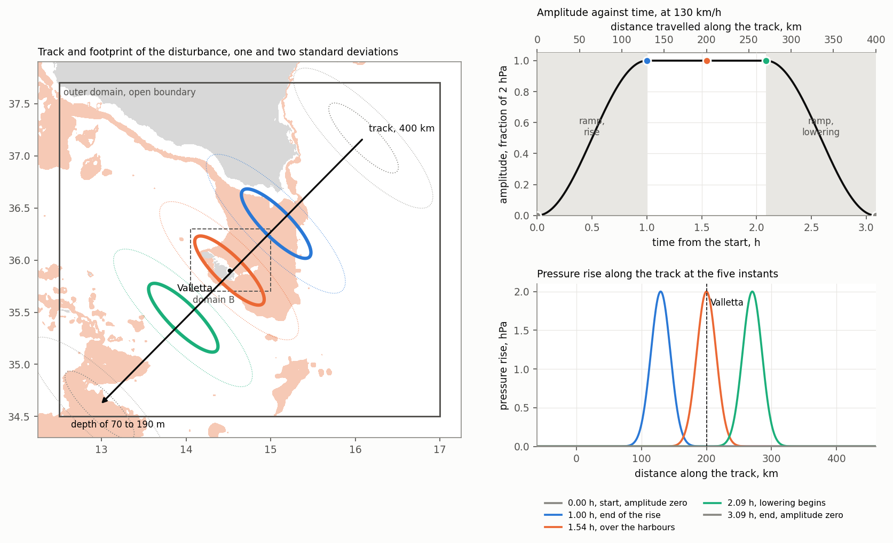
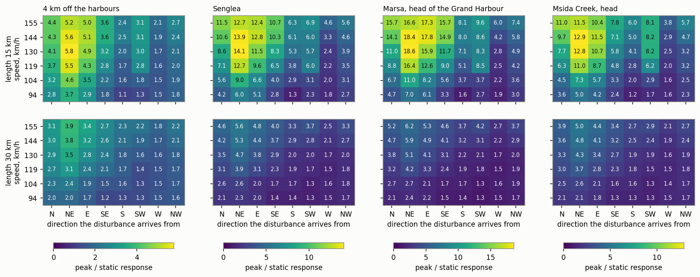

# Response of the Valletta harbours to moving pressure disturbances, the sweep

*Run 28 October 2026 on the outer mesh outer03 with the breakwaters of the Grand Harbour mouth closed by thin dams, with D-Flow FM 2026.01 (dflowfm-cli, serial, six scenarios side by side, 3 hours of wall time). Scenarios run by `scripts/run_longwave_sweep.py` through `scripts/build_longwave_scenario.py`, reduced by `scripts/analyse_longwave_sweep.py`. Figure at `figures/longwave_sweep_response.png`. The table of every scenario and station is written to `data/processed/longwave_sweep_response.csv`, which is regenerated by the reduction and is not versioned.*

The sweep maps the response of the shelf and of the harbours to an atmospheric pressure disturbance as a function of its speed, its direction and its length. It is the first evaluation of the component of the study concerned with the long wave, set out in Section 4.3 of [research_question_and_literature.md](research_question_and_literature.md), and it rests on the tests of [moving_pressure_channel_test.md](moving_pressure_channel_test.md) and on the pilot of [longwave_pilot.md](longwave_pilot.md), from which the outer domain, the track, the ramp and the numerical settings are taken.

---

## 1. Design

Each scenario is one pressure rise of 200 Pa, whose static response is 1.99 cm, of Gaussian shape, travelling at constant speed along a straight track of 400 km centred on the Valletta harbours, raised over the first 60 minutes and lowered over the last 60. The run lasts 12 simulated hours on the outer mesh outer03 of 35 840 faces, whose cells inside domain B are those of mesh v03 ([harbour_bathymetry_cleaning.md](harbour_bathymetry_cleaning.md)), two-dimensional and barotropic, with a Riemann boundary forced by zero and the tide-generating potential switched off. The St Elmo and Ricasoli breakwaters, narrower than the faces at the mouth, are closed by thin dams (Section 4 of [harbour_bathymetry_cleaning.md](harbour_bathymetry_cleaning.md)).

*One scenario, the disturbance arriving from the northeast at 130 km/h. Track of 400 km through the harbours with the footprint of the disturbance at one and two standard deviations at five instants, over the depths of 70 to 190 m (left), amplitude against time and distance travelled, with the two ramps shaded (top right), and pressure rise along the track at the same instants (bottom right). Drawn by `scripts/figure_longwave_scenario.py`.*

The track is the straight line along which the centre of the disturbance moves. The ramp is the interval over which its amplitude changes, from zero to the full rise at the beginning of the track and back to zero at its end, so that the disturbance is at full amplitude over the middle 140 km of the track at 130 km/h and at zero wherever its footprint reaches the open boundary.

| Quantity | Values |
|---|---|
| Speed | 26, 29, 33, 36, 40 and 43 m/s, that is 94, 104, 119, 130, 144 and 155 km/h |
| Direction of arrival | N, NE, E, SE, S, SW, W and NW |
| Length, standard deviation along the track | 15 and 30 km |
| Width, standard deviation across the track | 50 km, fixed |
| Scenarios | 96 |

The speeds span the long-wave celerity of depths between 69 and 188 m, the depths of the plateau between Malta and Sicily. Responses are reported in units of the static response. The pilot found the response proportional to the pressure rise within 2 per cent up to 10 hPa, so a value in these units applies to any rise in that range.

---

## 2. Response surface

*Largest departure of the water level from rest, in units of the static response, against the speed of the disturbance and the direction it arrives from, for lengths of 15 km (top) and 30 km (bottom), at 4 km off the harbours, at Senglea, at the head of the Grand Harbour at Marsa and at the head of Msida Creek. The colour scale differs between stations.*

The largest peak over the six speeds, by direction of arrival, for the length of 15 km.

| Station | N | NE | E | SE | S | SW | W | NW |
|---|---|---|---|---|---|---|---|---|
| Plateau, 30 km east of Malta | 3.3 | 2.3 | 2.5 | 4.1 | 3.4 | 2.4 | 2.9 | 2.7 |
| 4 km off the harbours | 4.4 | 5.8 | 5.1 | 3.6 | 2.5 | 3.1 | 2.1 | 2.7 |
| Grand Harbour, mouth | 6.0 | 8.0 | 6.7 | 4.6 | 3.5 | 4.3 | 2.4 | 3.4 |
| Senglea | 11.5 | 14.1 | 12.8 | 10.7 | 6.3 | 6.9 | 4.6 | 5.6 |
| Marsa, head of the Grand Harbour | 15.7 | 18.6 | 17.8 | 15.7 | 8.1 | 9.6 | 6.0 | 7.4 |
| Marsamxett, mouth | 6.5 | 8.3 | 7.3 | 5.0 | 3.0 | 4.8 | 2.5 | 3.6 |
| Msida Creek, head | 11.0 | 12.9 | 11.5 | 7.8 | 6.0 | 8.2 | 3.8 | 5.7 |
| Pietà Creek, head | 9.8 | 11.7 | 10.4 | 7.1 | 5.1 | 7.3 | 3.5 | 5.2 |

The same for the length of 30 km.

| Station | N | NE | E | SE | S | SW | W | NW |
|---|---|---|---|---|---|---|---|---|
| 4 km off the harbours | 3.1 | 3.9 | 3.4 | 2.7 | 2.3 | 2.2 | 1.8 | 2.2 |
| Senglea | 4.6 | 5.6 | 4.8 | 4.0 | 3.3 | 3.7 | 2.5 | 3.3 |
| Marsa, head of the Grand Harbour | 5.2 | 6.2 | 5.3 | 4.6 | 3.7 | 4.2 | 2.7 | 3.7 |
| Msida Creek, head | 3.9 | 5.0 | 4.4 | 3.4 | 2.7 | 2.9 | 2.1 | 2.7 |

The disturbance arriving from the northeast, 15 km long, against its speed.

| Speed, km/h | Plateau, 30 km east | 4 km off the harbours | Senglea | Marsa | Msida Creek, head |
|---|---|---|---|---|---|
| 94 | 1.8 | 3.7 | 6.0 | 7.0 | 5.0 |
| 104 | 2.0 | 4.6 | 9.0 | 11.0 | 7.3 |
| 119 | 2.2 | 5.5 | 12.7 | 16.4 | 11.0 |
| 130 | 2.3 | 5.8 | 14.1 | 18.6 | 12.8 |
| 144 | 2.2 | 5.6 | 13.9 | 18.4 | 12.9 |
| 155 | 2.2 | 5.2 | 12.7 | 16.6 | 11.5 |

---

## 3. Reading

The readings below are from idealised disturbances of one shape and one width on one track, and are indications of the structure of the response and not predictions of an event.

**The response depends strongly on the direction of arrival.** Disturbances from the sector between north and southeast give the largest response at every station of the harbours, with the maximum from the northeast, and those from the west the smallest. At Senglea the largest peak over the speeds is 14.1 times the static response from the northeast against 4.6 from the west, a factor of three. The sector of largest response is the one in which the track crosses the plateau between Malta and Sicily or its eastern edge before reaching the harbours. The University of Malta attributed the event of 18 June 2019 to atmospheric gravity waves from the east ([senglea_spectrum.md](senglea_spectrum.md), Section 7), which lies in that sector.

**From the northeast the response has a maximum inside the range of speeds.** It peaks at 130 to 144 km/h, the long-wave celerity of depths of 132 to 163 m, and falls on either side, which is the signature of Proudman resonance over the plateau. From the north, the east and the southeast the response rises to the upper end of the range, 155 km/h, so the maximum for those directions is not bracketed and the surface is open at its upper edge.

**The shorter disturbance excites the Grand Harbour, the longer one does not.** At 15 km the response at Senglea is 2.3 times that at 30 km in the median over the scenarios, and at Marsa 2.8 times, against 1.4 times off the harbours. The ratio of Senglea to the point 4 km off the harbours has a median of 2.0 and reaches 3.0 at 15 km, and a median of 1.2 at 30 km. The shorter disturbance carries more energy near the period of the fundamental mode of the Grand Harbour, which the pilot identified, and the dominant period at Senglea falls between 22 and 25 minutes in 44 per cent of the scenarios, with a median of 23.3 minutes and half of those scenarios between 23.2 and 23.6 minutes, beside the 23.0 minutes observed at Senglea ([senglea_spectrum.md](senglea_spectrum.md)). At the heads of Msida and Pietà Creeks the period of the Grand Harbour does not dominate in any scenario, the dominant period there having a median of 67 minutes, that of the shelf.

**Partition of the amplification in the most responsive scenario.** For the disturbance from the northeast at 130 km/h and 15 km, the peak is 2.3 times the static response on the plateau 30 km east of Malta, 5.8 times at 4 km from the harbours, 8.0 times at the mouth of the Grand Harbour and 18.6 times at Marsa. The shelf and the approach thus account for a factor near 6 and the Grand Harbour for a further factor of 3.2, while at 30 km the same factors are 3.5 and 1.4. For a pressure rise of 2 hPa the peak at Marsa is 37 cm, at Senglea 28 cm and at the head of Msida Creek 25 cm.

**Exposure by inlet.** Among the stations of the harbours, the head of the Grand Harbour at Marsa has the largest response in 91 of the 96 scenarios. Ranked by peak and averaged over the scenarios, the order is Marsa, French Creek, Senglea, Dockyard Creek, the heads of Msida and Pietà Creeks, Sliema Creek and the two mouths. On outer03 the stations at the heads of Marsa and Msida Creek stand within 11 m of the intended points and that of Pietà Creek 66 m from it. The removal of the pontoon and vessel returns from the bed opens the marina basin at Msida and the shipyard basin at Marsa, which the survey as supplied leaves dry, and raises the peaks at these heads by 2 to 4 per cent in the median over the scenarios and by up to 20 per cent in single scenarios, while elsewhere the peaks change by less than 5 per cent.

---

## 4. Limits

- **The pressure rise is a working value.** The 2 hPa of the scenarios was chosen for convenience and not from the events of Malta. Since the response is linear, the surface gives amplification factors, and the level reached in an event follows only once the size of its pressure jump, its rate of change and whether it is a single rise or a train of oscillations are read from the records.
- **One width and one shape.** The disturbance is Gaussian, 50 km across its track, and passes over the harbours. Narrower disturbances and tracks passing to one side were not run.
- **Pressure alone.** Wind stress, which accompanies the pressure jumps of observed events, is not applied.
- **Upper bound of the speeds.** The surface is open at 155 km/h for three directions. An extension to 180 km/h would bracket the maximum.
- **Heads of the inlets.** The bed under the pontoons at Msida and under the vessels at Marsa is interpolated from the surrounding survey ([harbour_bathymetry_cleaning.md](harbour_bathymetry_cleaning.md)), and the depth of the shipyard basin at Marsa is likely understated.
- **No test against events.** The dated events are to be located on the surface through the one-minute pressure records of the PORTO network, which give the speed, the direction and the length of each disturbance. That comparison is the test of the surface and awaits the records.
