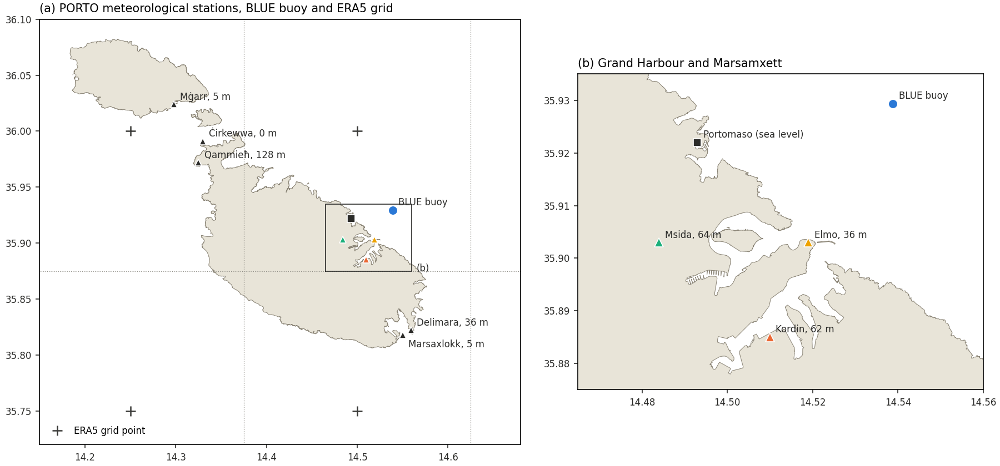
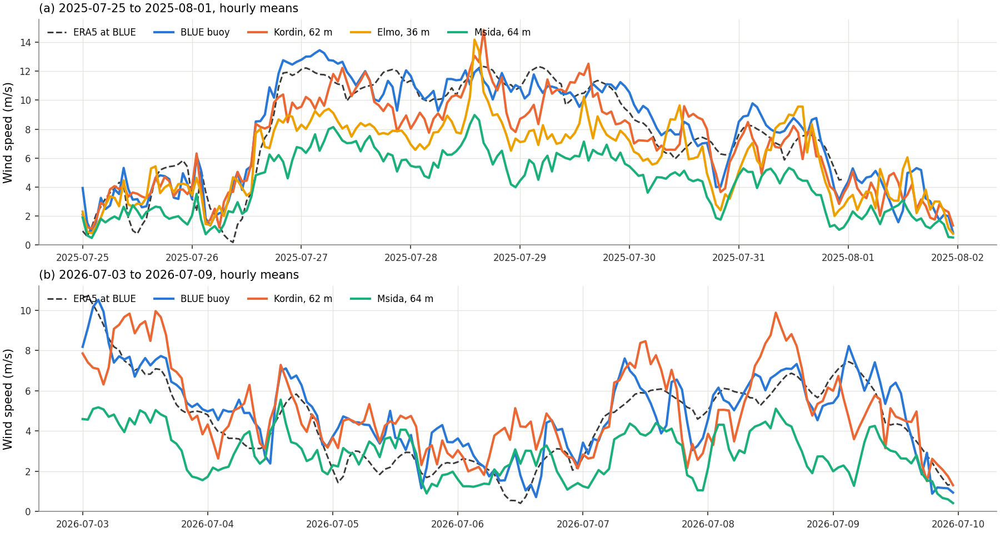
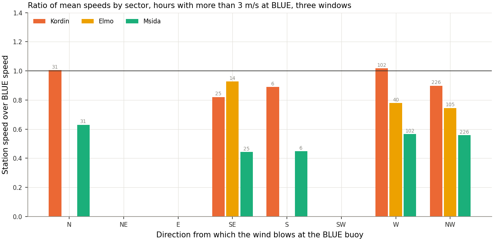
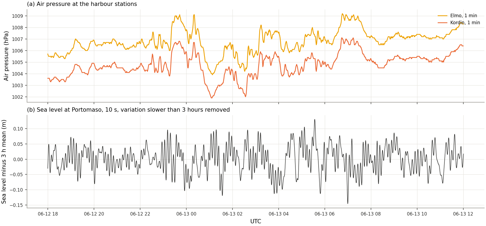

# The PORTO coastal stations

*Records served by the station portal of the Oceanography Malta Research Group at https://stations.ocean.mt/, downloaded by `scripts/download_porto_stations.py` into `data/raw/porto/<ref>/`, one CSV per station and day, not versioned.*

The PORTO network of the group comprises meteorological stations at the ports of Malta and Gozo and at Marina di Ragusa, together with sea level stations and wave buoys. The portal serves the record of each station through the same request its own pages issue, with the station reference and a range of dates, and the record so obtained is the full one-minute series for the meteorological stations and the 10-second series for the sea level stations. The portal states for each station the first and last day held, its position to 0.001 degree and the altitude of the sensor above mean sea level.

## 1. Stations

| Reference | Station | Position | Altitude (m) | Record held | Variables |
|---|---|---|---|---|---|
| MetElmo | Elmo, at the entrance of the Grand Harbour | 14.519 E, 35.903 N | 36 | 22 Sep 2023 to present, with gaps | wind speed, gust and direction, air temperature, air pressure, humidity, at 1 min |
| MetKord | Kordin, above the southern shore of the Grand Harbour | 14.510 E, 35.885 N | 62 | 22 Sep 2023 to present | as Elmo |
| MetMsida | Msida | 14.484 E, 35.903 N | 64 | 9 Oct 2024 to present | as Elmo, with global radiation and rain |
| MetDelim | Delimara | 14.559 E, 35.822 N | 36 | 22 Sep 2023 to present | as Elmo |
| MetMXlokk | Marsaxlokk | 14.550 E, 35.818 N | 5 | 2 Oct 2024 to 19 Jan 2026 | as Elmo |
| MetCirk, MetMgarG, MetQamm | Ċirkewwa, Mġarr (Gozo), Qammieħ | north-west of Malta and Gozo | 0, 5, 128 | Sep 2023 to present | as Elmo |
| SLevPMaso | Portomaso sea level, St Julian's | 14.493 E, 35.922 N | | 1 Dec 2023 to 19 Aug 2026, with gaps | sea level at 10 s |
| SLevMXlokk | Marsaxlokk sea level | 14.550 E, 35.818 N | | 13 Feb 2025 to 19 Jan 2026 | sea level |
| WBuoyBen | Wave buoy, Benghajsa | 14.540 E, 35.800 N | | 3 Jun 2024 to 14 Aug 2025 | sea temperature, wave height, period and direction |

*Reference, position and altitude as stated by the portal. The record held is the span stated by the portal, within which single days may be absent.*

The three stations on the harbours stand above the water. Kordin and Msida are at 62 and 64 m, and the position of Msida, rounded to 0.001 degree, falls on the high ground where the University campus stands, some half a kilometre north-west of the head of Msida Creek, rather than on the creek itself. Elmo is at 36 m on the tip of the Sciberras peninsula. None of the three is therefore a measurement of the wind over the water of the inlets. The grid of ERA5, at 0.25 degree, places almost the whole of the harbours inside the cell of the point at 14.50 E, 36.00 N, whose area is mostly sea.

*Meteorological stations of the PORTO network on Malta and Gozo with the altitude of the sensor, the Portomaso sea level station, the BLUE buoy and the points of the ERA5 grid with the edges of the cells they represent (a), and the stations on the Grand Harbour and Marsamxett (b). Positions as stated by the portal. Drawn by `scripts/figure_porto_stations.py`.*

Elmo holds no record in the windows of May and July 2026 used for the drifter runs, while Kordin and Msida cover both.

## 2. Wind of ERA5 against the stations

The hourly 10 m wind of ERA5, interpolated to each station, is compared with the hourly vector mean of the one-minute record over the three windows run by the model, the hindcast week of 25 July to 1 August 2025 and the drifter runs of 17 to 22 May and 3 to 9 July 2026. The BLUE buoy, 3.7 km off the Grand Harbour, serves as the reference over open water.

| Window | Station | Hours | Mean speed observed (m/s) | Mean speed ERA5 (m/s) | ERA5 over observed | Correlation of hourly speeds | Station over BLUE |
|---|---|---|---|---|---|---|---|
| Jul 2025 | BLUE | 168 | 8.40 | 8.02 | 0.95 | 0.93 | |
| | Elmo | 168 | 6.46 | 8.03 | 1.24 | 0.81 | 0.78 |
| | Kordin | 168 | 7.58 | 8.03 | 1.06 | 0.88 | 0.90 |
| | Msida | 168 | 4.62 | 8.05 | 1.74 | 0.86 | 0.55 |
| May 2026 | BLUE | 123 | 4.49 | 4.04 | 0.90 | 0.76 | |
| | Kordin | 144 | 5.01 | 4.82 | 0.96 | 0.79 | 0.99 |
| | Msida | 144 | 3.06 | 4.84 | 1.58 | 0.75 | 0.60 |
| Jul 2026 | BLUE | 168 | 4.92 | 4.49 | 0.91 | 0.88 | |
| | Kordin | 168 | 5.04 | 4.49 | 0.89 | 0.70 | 1.02 |
| | Msida | 168 | 2.92 | 4.51 | 1.55 | 0.60 | 0.59 |

*Mean speeds over the hours in which both records are present. The ratio of the station to BLUE is that of the mean speeds over the hours common to the two records. No correction is applied for the height of the anemometers.*

ERA5 reproduces the wind at BLUE within 5 to 10 per cent in the mean, slightly below it, and the wind at Kordin within 11 per cent, the exposed station on the high ground of the southern shore recording the wind of open water. At Elmo the record is a fifth below that of BLUE in 2025, and at Msida it is 55 to 60 per cent of BLUE in all three windows, so that ERA5, which does not resolve the islands at its grid of about 30 km, gives 1.55 to 1.74 times the wind recorded there. The correlation of hourly speeds stays between 0.60 and 0.88 at the stations, so that ERA5 carries the timing of the wind and departs mainly in its amplitude at the sheltered site.

*Hourly mean wind speed at the BLUE buoy and at the harbour stations, with the 10 m wind of ERA5 at the buoy, over the hindcast week of 2025 (a) and the drifter run of July 2026 (b). Elmo holds no record in July 2026.*

Over the hindcast week of 2025 the four records rise together into the north-westerly wind of 27 to 30 July, which ERA5 follows at the buoy within about 1 m/s, while Msida stays at 4 to 8 m/s against 10 to 13 m/s at BLUE and Elmo lies between the two. In July 2026 Msida departs most in the first day, at some 5 m/s against 8 to 10 m/s, and Kordin exceeds BLUE by 1 to 3 m/s in the strongest hours of 3 and 8 July, an excess that the altitude of the station and its exposure on the ridge above the dockyard plausibly account for.

*Ratio of the mean wind speed at each harbour station to that at the BLUE buoy, by the sector of the direction from which the wind blows at the buoy, over the hours of the three windows with more than 3 m/s at the buoy. The number of hours is marked above each bar, and sectors with fewer than six hours are left blank.*

The wind blew from the west and north-west in 328 of the 401 hours with more than 3 m/s at the buoy, and in those sectors Kordin records 0.90 to 1.02 of the speed at BLUE, Elmo 0.75 to 0.78 and Msida 0.56 to 0.57. Msida falls to 0.44 to 0.45 under the less frequent winds from the south-east and south, which cross the length of the island before reaching it, and rises to 0.63 under the northerly wind, which reaches it across Marsamxett. The ratio at Msida thus depends on the fetch over land upwind of the station.

The reduction at Msida combines the shelter of the Marsamxett side of the island from the prevailing north-westerly wind with the roughness of the built-up ground around the campus, and the record does not separate the two. The wind over the water of the inner creeks of both harbours is plausibly bounded by the stations, between the open-water value of BLUE and Kordin and the sheltered value of Msida, with a reduction that depends on the direction of the wind relative to the bastions and the inlets. For the circulation and renewal of the harbours, where the wind drives part of the exchange at the mouths, a reduction of the wind over the inner basins is therefore a sensitivity of the order of a factor of 0.6 to 1, to be set by direction once a station at water level, or the record of the group at Marsaxlokk at 5 m, constrains it. Offshore, where the drifters were tracked, the wind of ERA5 needs no correction of that order ([drifters_2026_dataset.md](drifters_2026_dataset.md), Section 5).

## 3. Records for the long wave

The one-minute air pressure of Elmo and Kordin and the 10-second sea level of Portomaso resolve the band of the milgħuba, 0.2 to 2 cycles per hour, and cover the dated event of 13 June 2024. Over 12 to 14 June 2024 the largest change of pressure in 10 minutes is 2.6 hPa at both stations, at Kordin at 23:27 UTC on 12 June and at Elmo at 03:15 UTC on 13 June, and the sea level at Portomaso, with the variation slower than 3 hours removed, ranges over 0.20 to 0.24 m within single hours from 01:00 to 07:00 UTC on 13 June. The earlier dated events, 18 June 2019, 30 June 2022 and 1 July 2023, precede the record held by the portal. Portomaso lies outside both harbours, at St Julian's, so that the record of 2024 gives the forcing and the response of the open coast and not the amplification inside the Grand Harbour.

*One-minute air pressure at Elmo and Kordin (a) and the 10-second sea level at Portomaso with its variation slower than 3 hours removed (b), from 18:00 UTC on 12 June to 12:00 UTC on 13 June 2024.*

The two pressure records move together, Kordin lying some 2 hPa below Elmo throughout, an offset of the sign and order of the 26 m between the altitudes of the two sensors, so that the record appears to be pressure at the station rather than reduced to sea level. From about 23:00 UTC on 12 June both carry a sequence of jumps and drops of 1 to 3 hPa within 10 to 30 minutes, the largest a fall of some 5 hPa between 00:10 and 01:15 UTC on 13 June. Over the same hours the oscillation of the level at Portomaso, of some 0.05 m before 23:00 UTC, reaches 0.10 to 0.15 m, the largest excursions between 01:00 and 07:00 UTC. The record of 2024 thus holds a disturbance of pressure and a response of the coast of the kind the sweep represents, and its test against the sweep requires the speed and direction of the disturbance, which the spacing of the stations of the network may constrain.
